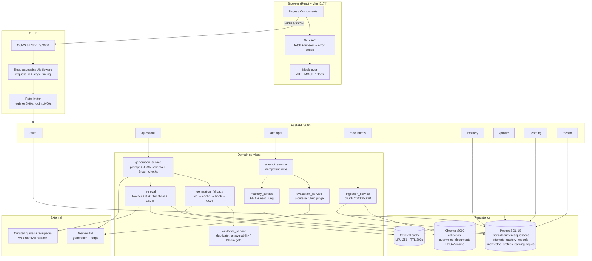
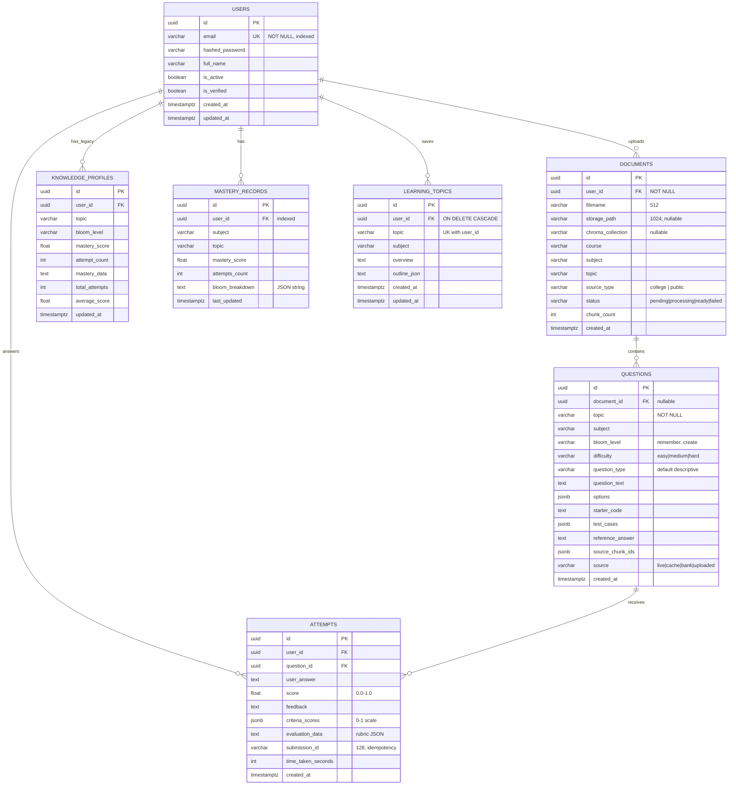
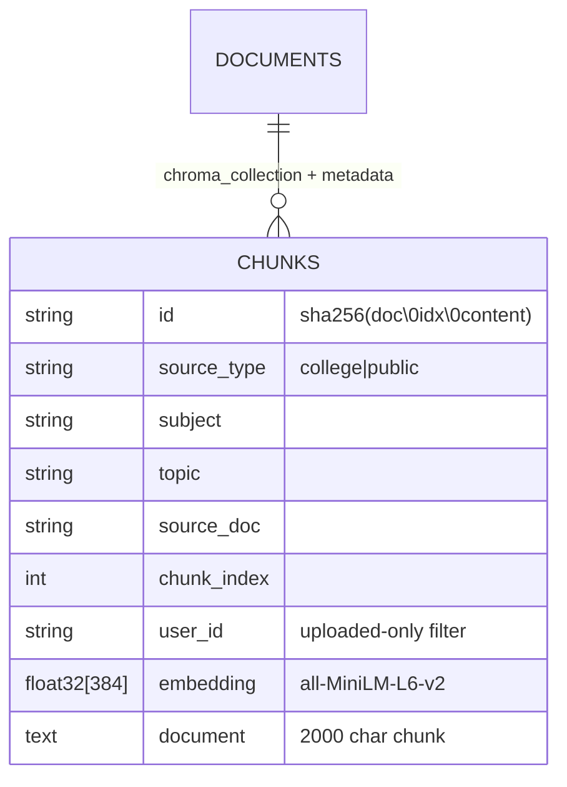
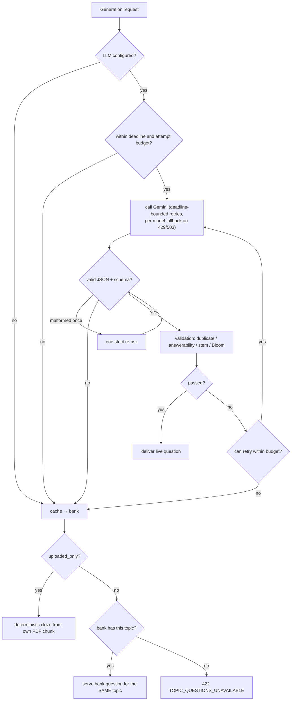
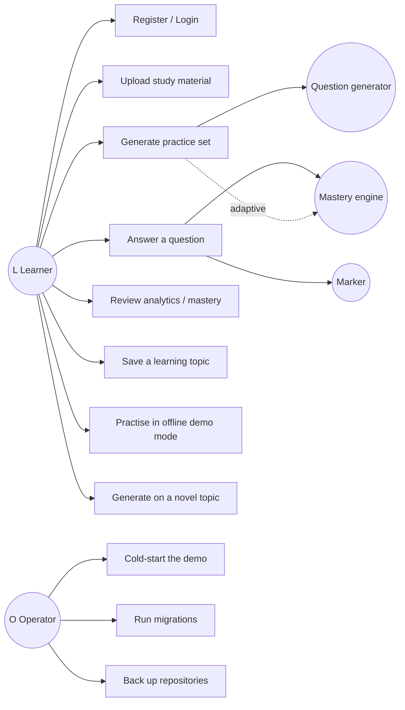

# QueryMind — Full Technical Project Documentation

> Deep technical reference: architecture, ER diagram, workflow diagrams, domain coverage
> (Operating Systems + DBMS), technical design, use cases, testing, deployment.
> Every number, threshold, table and endpoint below was read from the running code
> (`D:\querymind` backend branch `hardening`, `D:\querymind-frontend` branch `frontend-redesign`).

---

## Table of Contents

1. [Project Overview](#1-project-overview)
2. [Scope: OS and DBMS Learning Domains](#2-scope-os-and-dbms-learning-domains)
3. [Technology Stack](#3-technology-stack)
4. [System Architecture](#4-system-architecture)
5. [Database Design](#5-database-design)
6. [Activity and Sequence Diagrams](#6-activity-and-sequence-diagrams)
7. [Technical Design — Backend](#7-technical-design--backend)
8. [Technical Design — Frontend](#8-technical-design--frontend)
9. [Workflows in Depth](#9-workflows-in-depth)
10. [Use Cases](#10-use-cases)
11. [Non-Functional Requirements](#11-non-functional-requirements)
12. [Testing and Quality Assurance](#12-testing-and-quality-assurance)
13. [Deployment and Operations](#13-deployment-and-operations)
14. [Appendix](#14-appendix)

---

## 1. Project Overview

**QueryMind** is an adaptive, ground-up learning platform that writes exam-grade practice
questions on demand — from the learner's own uploaded study material or from a curated
question bank — and then moves the learner up or down a difficulty/Bloom ladder based on
real answers.

### 1.1 Problem

Revision tools usually serve a fixed question list. Students therefore waste time on what
they already know and never reach the level at which they are actually stuck. Marking is
either absent or a keyword-match that punishes correct-but-paraphrased answers.

### 1.2 Objectives

| # | Objective | How it is met |
|---|---|---|
| 1 | Generate fresh questions on any topic, on demand | Live LLM generation with a hard deadline, plus cache + bank fallback ladder |
| 2 | Ground questions in the learner's own material | PDF/DOCX/TXT/MD upload → chunking → Chroma vector retrieval → RAG prompt |
| 3 | Never serve a question outside the requested topic | Strict topic-scoped bank/cache lookup; served-question registry prevents repeats |
| 4 | Adapt difficulty to the learner | `next_rung()` one-rung-up / one-rung-down engine with hysteresis |
| 5 | Mark like a teacher, not a keyword matcher | 5-criterion rubric judged by an LLM, weights computed in code |
| 6 | Work with no internet / no LLM | `OFFLINE_DEMO_MODE`: bank generation + deterministic provisional evaluator |
| 7 | Degrade gracefully, never crash | Retries, cross-model fallback, deadline, sanitised errors, bank/cache ladder |
| 8 | Be provable | 310 unit/contract tests + real-browser Playwright proof suites |

### 1.3 Scope

- **In scope:** learner-facing practice engine (auth, upload, generate, answer, adapt),
  mastery analytics, notes/learning outlines, offline demo mode, Docker deployment.
- **Out of scope (intentionally):** multi-tenant admin console, LMS/SCORM export,
  collaborative features, native mobile apps, payment/billing.

### 1.4 Glossary of the core loop

```
topic → retrieval → LLM generation → validation → delivery → answer → rubric scoring
      → mastery EMA update → next_rung decision → next question
```

---

## 2. Scope: OS and DBMS Learning Domains

The shipped question bank and the demo material are concentrated on two classic
undergraduate domains — **Operating Systems** and **DBMS** — because both are
*deterministic* enough to be graded reliably and *procedural* enough to benefit from a
Bloom ladder (remember a definition → apply an algorithm → analyse a schedule → evaluate
a trade-off).

### 2.1 Why these two domains

| Property | Operating Systems | DBMS |
|---|---|---|
| Concept shape | algorithms + invariants (scheduling, paging, deadlock) | models + guarantees (normalisation, ACID, concurrency) |
| Ideal Bloom progression | define paging → compute page faults → analyse a replacement policy → evaluate Belady's anomaly | define ACID → write a join → analyse a normal form violation → evaluate 2PL vs MVCC |
| Gradeability | numeric/algorithmic reference answers exist | reference answers have canonical key phrases ("hold and wait", "2PL") |
| Offline marking | provisional scorer has two dozen hand-written concept rule keys (FCFS, SJF, round robin, aging, starvation, mutual exclusion, hold and wait, no preemption, circular wait, atomicity, isolation, 2PL, WAL, …) | same |

### 2.2 How the domains are encoded

- `questions.subject` carries the domain (`OS`, `DBMS`, …); `questions.topic` the unit
  (e.g. *Process Scheduling*, *Deadlock*, *Virtual Memory*, *Transactions*).
- `TOPIC_TO_SUBJECT` (`generation_fallback.py:111-125`) pins each topic to **one**
  subject so mastery can never be split across two subject labels for the same content.
- `KNOWN_TOPIC_CANONICAL` (`generation_fallback.py:78-109`) maps learner aliases
  ("paging", "vm", "virtual memory") onto one canonical topic key, so the mastery record
  and the served-question registry stay coherent no matter how the learner types it.
- Every generated question carries `bloom_level` × `difficulty`; the adaptive ladder
  walks `(remember,easy) → … → (create,hard)`.

> The full per-topic concept inventory (every OS topic and every DBMS topic, with counts
> and Bloom coverage) is listed in [§14.1](#141-os-concept-inventory) and
> [§14.2](#142-dbms-concept-inventory).

---

## 3. Technology Stack

### 3.1 Backend

| Layer | Technology | Version/notes | Why |
|---|---|---|---|
| Language | Python | 3.11 (`python:3.11-slim`) | typed, mature ML ecosystem |
| Web framework | FastAPI | async-ready, Pydantic v2 schemas | auto OpenAPI, dependency injection for auth |
| ORM / DB driver | SQLAlchemy 2.x + psycopg2 | sync sessions | explicit transactions for the attempt write path |
| Migrations | Alembic | 10 revisions, linear chain | additive-only schema evolution |
| Primary DB | PostgreSQL 15 (`postgres:15-alpine`) | JSONB for rubric/metadata | `ON CONFLICT` upserts, partial indexes |
| Test DB | SQLite (in-memory, `StaticPool`) | per-test fixtures | fast, no `conftest.py` needed |
| Vector DB | ChromaDB 0.5.0 | HNSW, `cosine` space | `all-MiniLM-L6-v2` (384-d) embeddings |
| LLM | Google Gemini (`gemini-3.5-flash-lite` primary) | structured output, JSON schema | generation + judging |
| Embeddings | Chroma `DefaultEmbeddingFunction` (ONNX, all-MiniLM-L6-v2) | downloaded at image build | no network at runtime |
| Passwords | passlib + bcrypt | HS256 JWT, 60 min access / 7 d refresh | standard |
| Tests | pytest | 310 test functions / 382 collected | |

### 3.2 Frontend

| Layer | Technology | Notes |
|---|---|---|
| UI runtime | React + Vite | pinned port **5174** in the demo |
| Language | JavaScript (JSX) | |
| Routing | react-router | page map in §8.1 |
| Styling | CSS design tokens + component library | theme in §8.3 |
| Data layer | typed API client over `fetch`, `VITE_API_BASE_URL` | timeouts + structured error codes |
| Mocks | feature-flagged (`VITE_USE_MOCKS`, `VITE_MOCK_*`) | learner-domain mocks **off** in demo; catalog/content mocks **on** |
| E2E proof | Playwright (headless Chrome at `C:\Program Files\Google\Chrome\Application\chrome.exe`) | suites in §12.3 |

### 3.3 Infrastructure

Docker Compose with three services and two named volumes (`postgres_data`, `chroma_data`),
plus a single-service `render.yaml` for cloud deployment.

---

## 4. System Architecture

### 4.1 Component diagram



### 4.2 Deployment topology (demo)

```mermaid
flowchart LR
    subgraph Host["Windows host"]
        PS[start-demo.ps1]
        FE["npm run dev :5174"]
        PS --> FE
        PS --> C
        subgraph C["docker compose"]
            BK[querymind_backend :8000<br/>uvicorn 2 workers<br/>alembic upgrade head first]
            DB2[querymind_db :5432<br/>postgres:15-alpine]
            CH2[querymind_chroma :8001→8000<br/>chromadb 0.5.0]
            BK --> DB2
            BK --> CH2
        end
    end
    BK -.bind mount ./backend.-> CODE[Edited Python code]
    BK -->|generativelanguage.googleapis.com| GEM2[Gemini]
```

Key property: the backend is **bind-mounted** (`./backend:/app`) but uvicorn runs **without
`--reload`**, so any Python edit requires recreating the container — which is exactly what
`start-demo.ps1` now does before checking ports.

### 4.3 Request lifecycle (one API call)

1. Client sends `POST` with `Authorization: Bearer <access JWT>`.
2. `RequestLoggingMiddleware` mints `request_id`, sets `X-Request-ID`.
3. Rate limiter checks the sliding window for auth routes.
4. `get_current_user` decodes HS256 token, enforces `type=access`, loads the user.
5. Route handler runs a service inside a session; the response is serialised by Pydantic.
6. Structured JSON log line with `latency_ms`, plus `stage_timing` for generation/evaluation.
7. Any failure passes through the global handlers in `main.py:72-142`, which always return
   `{detail, code, request_id}` — never a stack trace.

---

## 5. Database Design

### 5.1 Entity-Relationship Diagram



**External (non-relational) entity — Chroma vector store**



### 5.2 Physical schema — constraints and indexes

| Table | Keys & constraints | Indexes | Notes |
|---|---|---|---|
| `users` | PK `id` UUID; **UNIQUE `email`** | `ix_users_email` | `created_at`/`updated_at` server defaults |
| `documents` | PK `id`; FK `user_id → users.id` NOT NULL | — | no relationship attribute declared; no `is_private` column |
| `questions` | PK `id`; FK `document_id → documents.id` nullable | **`ix_questions_topic_bloom_difficulty (topic, bloom_level, difficulty)`** | `source` NOT NULL default `'live'`; `document_id` null for bank/cache questions |
| `attempts` | PK `id`; FK `user_id`, `question_id` NOT NULL; **UNIQUE `(user_id, question_id, submission_id)`** | **`ix_attempts_user_created (user_id, created_at)`** | idempotent submits; history + mastery replay |
| `knowledge_profiles` | PK `id`; FK `user_id`; **not unique** per (user, topic, bloom) | `ix_knowledge_profile_user_topic_bloom` | **legacy, read-only** |
| `mastery_records` | PK `id`; FK `user_id`; **UNIQUE `(user_id, subject, topic)`** | `ix_mastery_records_user_id` | **authoritative** mastery store |
| `learning_topics` | PK `id`; FK `user_id ON DELETE CASCADE`; **UNIQUE `(user_id, topic)`** | `ix_learning_topics_topic`, `ix_learning_topics_user_id` | newest table |

Type notes: all PKs are `UUID` with `uuid.uuid4` defaults; JSON columns are
`JSONB().with_variant(JSON, "sqlite")` so the same model runs on Postgres and on the
SQLite test DB; **no SQLAlchemy `Enum` types are used** — enum-like fields are `String`
with documented value sets (avoids Postgres/SQLite enum divergence).

### 5.3 Schema evolution — Alembic migrations (additive only)

Linear chain, head `338aa1900257`. Production entrypoint runs `alembic upgrade head`
**before** uvicorn starts (`Dockerfile:31`, `docker-compose.yml:99`).

| Revision | Date | Change |
|---|---|---|
| `1012241bab96` | 2026-09-02 | initial: `users`, `documents`, `questions`, `attempts`, `knowledge_profiles` |
| `c7a1f4e2b9d3` | 2026-10-15 | + `questions.subject` (subject-aware duplicate detection) |
| `d1e5b7c3a2f4` | 2026-10-15 | + `attempts.evaluation_data` (rubric JSON) |
| `e2a6c8d4b3f5` | 2026-10-15 | + `documents.chunk_count`; backfills `course/subject/topic/source_type` |
| `e2f6a8b1c4d5` | 2026-10-15 | + `attempts.criteria_scores`, question payload columns, knowledge-profile columns; creates the two composite indexes; JSON→JSONB variant |
| `f3b7d9c1a2e4` | 2026-10-15 | creates `mastery_records` + `uq_mastery_user_subject_topic` |
| `b9c0d1e2f3a4` | 2026-10-17 | creates `ix_attempts_user_created` for history/mastery replay |
| `a1b2c3d4e5f6` | 2026-11-22 | + `attempts.submission_id` + unique constraint (idempotency), batch, NULL allowed |
| `b2c3d4e5f6a7` | 2026-11-22 | + `questions.source` NOT NULL default `'live'` (provenance) |
| `338aa1900257` | 2026-11-24 | creates `learning_topics` (CASCADE FK, unique user+topic) |

Policy: **no destructive migration is permitted** — every revision is additive (new column
with default/NULL, new table, new index). Index creation is wrapped in `try/except` so a
partially-applied migration cannot brick startup. `test_migrations.py` runs a real
`upgrade`/`downgrade` cycle on a temp SQLite file and refuses to run against the dev DB.

### 5.4 Normalisation analysis

| Form | Verdict | Evidence |
|---|---|---|
| **1NF** | ✅ | atomic columns everywhere; multi-valued data (`options`, `test_cases`, `source_chunk_ids`, `criteria_scores`) is stored in typed JSONB, not repeated rows |
| **2NF** | ✅ | composite uniqueness (`user_id, subject, topic`) and (`user_id, question_id, submission_id`) have no partial dependency on a subset of a candidate key — all PKs are single-column UUIDs |
| **3NF** | ✅ for relational columns | no transitive dependency: `subject` on `questions` is a domain attribute of the question, not of the document; `topic`→`subject` pinning lives in code (`TOPIC_TO_SUBJECT`), not as a derived column |
| **BCNF** | ✅ | every determinant is a candidate key |
| Deliberate denormalisation | `attempts.evaluation_data`, `attempts.criteria_scores`, `mastery_records.bloom_breakdown`, `learning_topics.outline_json` | these are *snapshots of computation*, written once and read as a whole; splitting them into rows would cost a join per render for no update benefit |

**Two coexisting mastery stores** (a real design decision worth defending):

- `knowledge_profiles` — legacy, per-(user, topic, bloom) rows, **not** written by the
  answer path anymore (`adaptive_service.LEGACY_TABLE`), retained read-only for old data.
- `mastery_records` — authoritative, **one row per (user, subject, topic)**, EMA-updated,
  with a per-Bloom JSON breakdown. All adaptive decisions read this.

### 5.5 Cardinality and integrity rules

| Relationship | Type | Integrity rule |
|---|---|---|
| `users → documents` | 1 : N | FK NOT NULL, no cascade (a user's uploads are evidence, never silently deleted) |
| `documents → questions` | 1 : 0..N | `document_id` nullable: bank/cache questions are not tied to an upload |
| `users → attempts` | 1 : N | FK NOT NULL; history query is `(user_id, created_at)` indexed |
| `questions → attempts` | 1 : N | FK NOT NULL; a question cannot exist without at least the possibility of attempts |
| `users → mastery_records` | 1 : 1 per (subject, topic) | `ON CONFLICT (user_id, subject, topic) DO NOTHING` + `SELECT … FOR UPDATE` |
| `users → learning_topics` | 1 : N | **`ON DELETE CASCADE`**, unique `(user_id, topic)` |
| `documents → chunks` (Chroma) | 1 : N | chunk id = `sha256(source_doc \0 index \0 content)` → **deterministic upsert**, so re-uploading the same file is idempotent |
| `chunks → users` (metadata) | N : 1 | `user_id` in chunk metadata powers the **uploaded-only** filter |

---

## 6. Activity and Sequence Diagrams

### 6.1 Question generation (activity)

```mermaid
flowchart TD
    A[POST /questions/generate<br/>JWT + topic + bloom + difficulty] --> B{adaptive?}
    B -- yes --> C[adaptive_recommendation<br/>next_rung over last 24 attempts]
    B -- no --> D[use requested bloom/difficulty]
    C --> D
    D --> E["deadline = now + generation_deadline_seconds"]
    E --> F[Retrieval: two-tier, cosine ≥ 0.45<br/>cache LRU 256 / TTL 300s]
    F --> G{uploaded_only?}
    G -- yes, 0 chunks --> H[404 NO_CONTEXT]
    G -- no --> I[generation_fallback.generate_one]
    I --> J{offline_demo_mode?}
    J -- yes --> K[cache → bank (no LLM)]
    J -- no --> L["LLM attempt 1: prompt + JSON schema<br/>deadline-bounded retries"]
    L --> M[validation_service]
    M --> N{passed?}
    N -- yes --> O[persist + mark_served under<br/>typed AND served topic]
    N -- "duplicate" --> P[retry with 'different angle' note]
    N -- "cognitive" --> Q{distance ≤ 2?}
    Q -- attempt 0 --> R[strict Bloom rewrite, retry once]
    Q -- yes, later --> S[keep question, store CLASSIFIED level<br/>+ context_warning]
    Q -- no, later --> T[fallback]
    P --> L
    R --> L
    K --> O
    T --> U["_question_from_cache → _bank_candidates<br/>(same topic only)"]
    U --> O
    O --> V[Return GeneratedQuestionsResponse<br/>source, served_topic, source_chunks, context_warning]
```

### 6.2 Answer → scoring → mastery (sequence)

```mermaid
sequenceDiagram
    participant U as Learner
    participant FE as React app
    participant API as FastAPI
    participant ES as attempt_service
    participant EV as evaluation_service
    participant LLM as Gemini judge
    participant MS as mastery_service
    participant DB as PostgreSQL

    U->>FE: types answer, clicks Submit
    FE->>API: POST /attempts/submit {question_id, user_answer, submission_id}
    API->>ES: submit_attempt_core()
    ES->>DB: SELECT attempt by (user, question, submission_id)
    alt duplicate submission
        ES-->>FE: stored result, duplicate_submission=true
    else new submission
        ES->>DB: rollback (no lock held during judging)
        ES->>EV: evaluate_answer(question, answer)
        alt exact reference match
            EV-->>ES: 100.0, mode=exact_reference (no LLM)
        else offline mode or LLM unavailable
            EV->>EV: evaluate_answer_provisional (deterministic)
            EV-->>ES: 0-100, mode=provisional
        else live judge
            EV->>LLM: rubric prompt (injection-guarded answer block)
            LLM-->>EV: 5 criteria 0-10
            EV->>EV: weighted sum in code → 0-100
            EV-->>ES: score, mode=live
        end
        ES->>DB: BEGIN; INSERT attempt; update_mastery()
        MS->>DB: ON CONFLICT DO NOTHING then SELECT FOR UPDATE
        MS->>MS: EMA = clamp(0.3*weighted + 0.7*old)
        MS->>DB: UPDATE mastery_records + bloom_breakdown
        ES->>DB: COMMIT
        ES-->>FE: {score, feedback, criteria_scores, rung, reason}
    end
    FE->>FE: render score card + new rung badge
```

### 6.3 Upload → ingestion → retrieval (activity)

```mermaid
flowchart TD
    A[POST /documents/upload<br/>multipart file + subject/topic] --> B{size ≤ 10 MB?}
    B -- no --> C[413 FILE_TOO_LARGE]
    B -- yes --> D{extension in pdf/docx/txt/md?}
    D -- no --> E[422 unsupported]
    D -- yes --> F["extract (pypdf / python-docx incl. tables / utf-8→utf-16→latin-1)"]
    F --> G{any text?}
    G -- no --> H[422 ValidationError + OCR hint]
    G -- yes --> I["chunk: paragraphs → sentences → greedy pack<br/>2000 chars, 250 overlap, drop < 80"]
    I --> J["id = sha256(doc \\0 index \\0 content) → upsert"]
    J --> K[Chroma upsert into querymind_documents<br/>metadata: source_type, subject, topic, source_doc,<br/>chunk_index, user_id]
    K --> L[(UPSERT documents row<br/>status=ready, chunk_count=N)]
    L --> M[invalidate_retrieval_cache subject+topic]
    M --> N[200 {document, chunks_ingested, subject, topic}]
```

### 6.4 Failure / fallback decision flow



---

## 7. Technical Design — Backend

### 7.1 API reference

Global error envelope: `{ "detail": str, "code": str, "request_id": str }` + `X-Request-ID`.

**Auth — `/auth`**

| Method | Path | Auth | Limits / codes |
|---|---|---|---|
| POST | `/auth/register` | — | 5 req/60 s → `429 RATE_LIMIT_EXCEEDED`; `409 CONFLICT` duplicate email; `422` password < 8 chars; **201** `TokenResponse` |
| POST | `/auth/login` | — | 10 req/60 s; `401 AUTHENTICATION_ERROR` |
| POST | `/auth/token` | OAuth2 form | Swagger Authorize; same 10/60 s |
| POST | `/auth/refresh` | refresh JWT | 60 min access / 7 d refresh |
| GET | `/auth/me` | access JWT | 401 invalid/expired/inactive |

**Questions — `/questions`**

| Method | Path | Behaviour |
|---|---|---|
| POST | `/questions/generate` | `num_questions` 1–10; `bloom_level`+`difficulty` required unless `adaptive=true`; sets the generation deadline; retrieval runs when `uploaded_only OR not offline_demo_mode`; `404 NO_CONTEXT`, `422 TOPIC_QUESTIONS_UNAVAILABLE`, `503 LLM_NOT_CONFIGURED / LLM_QUOTA_EXHAUSTED / LLM_UNAVAILABLE`, `502 GENERATION_FAILED` |
| POST | `/questions/{id}/submit-answer` | delegates to `submit_attempt_core`; `404 NOT_FOUND`, `422` blank/over-long (max 5000 chars) |

**Attempts — `/attempts`**

| Method | Path | Behaviour |
|---|---|---|
| POST | `/attempts/submit` | idempotent on `(user, question, submission_id)`; `404` unknown question |
| GET | `/attempts/history/{user_id}` | **`403 FORBIDDEN`** unless `user_id == current_user.id` |

**Documents — `/documents`** — `POST /documents/upload` (multipart; `413` > 10 MB, `422`
empty/unsupported), `GET /documents/topics`, `GET /documents` (own rows, newest first).

**Others** — `GET /profile/{user_id}` (`403` for other users), `GET /mastery/me`,
`POST|GET /learning/topics`, `GET /learning/topics/{id}` (`404` for foreign topics).

**Health** — `GET /` (version banner), `GET /health/live` (no deps), `GET /health`
(component snapshot: database, chroma, llm, security; **503 iff DB unhealthy**).

### 7.2 Authentication and security model

- **JWT HS256**, payload `{sub, type: access|refresh, exp, iat}`; access **60 min**,
  refresh **7 days**; `decode_token` enforces the expected `type`.
- **Passwords**: bcrypt via passlib, with two compatibility patches (72-byte truncation,
  `__about__` shim) for modern `bcrypt` releases. Minimum 8 characters.
- **Rate limiting**: in-memory sliding window keyed by client IP, `Lock`-guarded,
  `429 RATE_LIMIT_EXCEEDED` — applied to register/login/token only.
- **CORS**: explicit origin allow-list (5174/5173/3000 + 127.0.0.1), credentials on.
- **Ownership guards**: attempt history 403, profile 403, learning topics scoped by
  `user_id`, documents list scoped by `user_id`, mastery always from the JWT.
- **Upload hardening**: filename sanitised against path traversal; 10 MB cap → `413`.
- **Prompt-injection hardening**: the learner's answer is wrapped in
  `<<<STUDENT_ANSWER … STUDENT_ANSWER>>>` with an explicit instruction that text inside
  is data, not commands.
- **Error sanitisation**: raw provider/SDK text is logged server-side only; responses only
  ever carry fixed classified codes (`LLM_QUOTA_EXHAUSTED`, `LLM_UNAVAILABLE`, …).
- **Startup guard**: if `DEBUG=false` and `SECRET_KEY` is still the shipped default, the
  app refuses to start; `/health` reports `security: degraded` while in debug.
- **Secrets**: `.env` is excluded by `.dockerignore` and is never committed.

### 7.3 Retrieval and RAG pipeline

1. **Collection**: `querymind_documents`, HNSW index, `hnsw:space=cosine`.
2. **Embeddings**: `all-MiniLM-L6-v2`, 384 dimensions, ONNX/CPU (downloaded at image build
   so runtime needs no network).
3. **Two-tier search**: Tier 1 `source_type="college"` (the learner's own material);
   if empty or top score `< 0.45`, Tier 2 `source_type="public"`. If neither clears the
   threshold the **best available** result is returned (college preferred) rather than
   nothing; `[]` only when both tiers are empty.
4. **Similarity**: `round(max(0.0, 1.0 - distance), 4)`; **`SIMILARITY_THRESHOLD = 0.45`**
   (recalibrated down from an unreachable 0.75).
5. **Cache**: `OrderedDict` LRU keyed `(subject, topic, mode, strict, user_id, query)`,
   TTL **300 s**, **256** entries; bypassed when a client/collection is injected for tests;
   invalidated by ingestion.
6. **Uploaded-only mode**: `college_only=true`, `strict_metadata=false`, plus a
   `{"user_id": …}` filter — the typed topic title is *not* required to match, so a PDF
   titled differently from the typed topic is still found **semantically**.
7. **Web fallback** (only when both tiers fail): curated `study_guides.json` (11 topics),
   else Wikipedia OpenSearch → extracts truncated to **1200 chars** (3 s/5 s timeouts),
   else a generated "educational scaffold" chunk scored 0.85.

### 7.4 Question generation pipeline

- **Prompt construction** (`_build_prompt`, `generation_service.py:480-575`): cognitive
  definition of the requested Bloom level, REQUIRED opening verb + FORBIDDEN lower-level
  verbs (checked against the first 3–6 words of the stem by `check_stem`), a
  concrete-scenario rule for Apply and above, question-type instructions (MCQ → exactly 4
  options; coding → starter code + 2 test cases; descriptive → reference answer), the
  retrieved source material block, and the JSON schema description.
- **Structured output**: `response_mime_type="application/json"` with a Pydantic-derived
  schema; `GeminiAdapter` centralises `GenerateContentConfig`, logs `finish_reason` and
  token usage, and **retries once with a doubled token cap (up to 65536)** when
  `finish_reason=MAX_TOKENS` would otherwise truncate JSON.
- **Thinking budget**: per-Bloom routing —
  `remember=low, understand=low, default=medium` (measured optimum), with level taking
  precedence over an explicit budget for Gemini 3.
- **Validation gates** (`validation_service`, thresholds):
  - duplicate similarity **≥ 0.95** against same subject+topic questions, **excluding**
    bank questions (`source='bank'`);
  - answerability: best **≥ 0.50**, or **≥ 0.40 with keyword overlap ≥ 0.30**;
  - stem/verb compliance (`check_stem`);
  - cognitive alignment: an LLM classifies the actual Bloom level, tolerance
    `remember=1, understand=1, default=0`; if the judge fails the gate is skipped
    rather than blocking delivery.
  Duplicate + answerability run concurrently in a `ThreadPoolExecutor(max_workers=2)`.
- **Delivery policy** (`generate_one`): `passed` → return; `duplicate` → retry with an
  explicit "different angle" note; `cognitive` on attempt 0 → one strict rewrite, on a
  later attempt with **distance ≤ 2** the question is kept and its *classified* level is
  stored with a `context_warning`; distance > 2 → fallback. Any exception breaks to the
  fallback ladder. **A question is never thrown away after two LLM calls.**

### 7.5 Evaluation service

- **Rubric (5 criteria, weights summed in code):**
  `conceptual_correctness 0.35`, `completeness 0.25`, `technical_depth 0.20`,
  `example_application 0.10`, `clarity 0.10`. Sub-scores are clamped to 0–10, never
  rejected; `overall = round(weighted × 10, 2)` → **0–100** (the LLM's own "overall" field
  is ignored so arithmetic is deterministic).
- **Exact-reference short-circuit**: a verbatim (token-set normalised) match with
  `reference_answer` returns **100** with `evaluation_mode="exact_reference"` and **never
  calls the judge**. Rationale: a terse correct answer such as "A page" must not be marked
  down, and the adaptive demo depends on exact answers scoring full marks.
- **Live judge**: temperature 0.0, 2048-token cap, structured output; one strict re-ask on
  malformed JSON, else `502 EVALUATION_FAILED`.
- **Provisional evaluator** (offline mode, or automatic fallback when the judge is
  unavailable): extracts `(label, claim)` pairs from the reference, keyword overlap +
  cosine similarity (all-MiniLM-L6-v2), plus **two dozen hand-written concept rule keys** for OS/DBMS
  key phrases with contradiction penalties (**−0.62** severe, **−0.42** ordinary).
  Output is always labelled `evaluation_mode="provisional"` — the UI never presents it as a
  teacher's mark.
- **Output contract**: `score` 0–1, `criteria_scores` 0–1 (sub-scores divided by 10),
  `overall_score` 0–100, `feedback`, `missing_points`, `strengths`, `evaluation_mode`.

### 7.6 Adaptive mastery engine

**Rung ladder** (`mastery_service.RUNG_LADDER`) — 6 rungs, each a `(bloom_level, difficulty)`
pair:

| Rung | Bloom | Difficulty |
|---|---|---|
| 0 | remember | easy |
| 1 | understand | easy |
| 2 | apply | medium |
| 3 | analyze | medium |
| 4 | evaluate | hard |
| 5 | create | hard |

**Mastery score** — exponential moving update per (user, subject, topic):

```
weighted = clamp(normalize_score(score) × difficulty_weight)   # easy 0.8 · medium 1.0 · hard 1.2
first attempt → seed = weighted
else           → mastery = clamp(0.3 × weighted + 0.7 × previous)     # EMA_ALPHA = 0.3
```

The same EMA is maintained per Bloom level inside `bloom_breakdown` (JSON). The write is
atomic: `INSERT … ON CONFLICT DO NOTHING` then `SELECT … FOR UPDATE`, so two concurrent
submissions cannot both "seed" the record.

**`next_rung(current_rung, recent_scores)` — pure decision function, at most one step:**

1. No history → stay (reason: "starting at …").
2. **Demotion first**: last **3** scores, mean **< 0.40** → rung − 1 (floor 0).
3. **Promotion**: last **4** scores, mean **≥ 0.70** *and* minimum **≥ 0.40** → rung + 1
   (cap 5). Any last-4 score `< 0.40` → stay, reason names the offending score; otherwise
   stay with the average.
4. Fewer than 4 answers → stay, reason `"{n}/4 questions answered"`.

**Hysteresis (anti-bounce):** on *every* rung change `_adaptive_state` sets
`demotion_pending = (target < rung)` and **clears the recent-score history**. Consequences:

- after a drop, the learner must produce **fresh** answers before climbing again —
  no immediate bounce back;
- promotion needs 4 good answers, demotion needs only 3 bad ones → the ladder is
  deliberately quicker to protect the learner from frustration than to push them up;
- history is capped at **24** attempts for the decision window.

The engine is exercised by a table-driven pure test suite
(`test_mastery_next_rung.py`) covering the 0.40/0.70 boundaries, floor/ceiling, and the
"4 to promote / 3 to demote" pacing.

### 7.7 Reliability layer

| Mechanism | Detail |
|---|---|
| Transient retry | exponential backoff 1, 2, 4, 8 s over 5 attempts for 408/409/425/429/500/502/503/504, timeouts, connection resets |
| Hard per-call timeout | daemon worker thread + `join(timeout)` (default 20 s) so a hung HTTP call can never block a worker forever |
| Concurrency cap | process-wide `BoundedSemaphore(3)` Gemini calls in flight |
| **Deadline-bounded retry loop** | a caller deadline bounds the **whole** loop, not each attempt: when ≤ 0.5 s remains the loop stops. This prevents "4 retries × 15 s = 60 s" from overrunning the generation budget (and the browser timeout) before the fallback runs |
| Cross-model fallback | `LLM_FALLBACK_MODELS` chain, tried only on 429/RESOURCE_EXHAUSTED or persistent 503 |
| Generation budget | `generation_deadline_seconds`, `generation_call_timeout_seconds`, `generation_max_attempts = 2`, `generation_max_fallback_models` |
| Ladder fallback | live → DB cache (`source in (live,cache)`, same topic, unserved preferred) → seeded bank (same topic only, rung-distance ordered) → deterministic cloze from the learner's own PDF chunk |
| Error sanitisation | classified `503 LLM_QUOTA_EXHAUSTED` / `503 LLM_UNAVAILABLE`; raw provider text never leaves the process |
| Offline mode | `OFFLINE_DEMO_MODE` makes zero LLM calls: bank/cache generation + provisional evaluator |
| Idempotency | attempt unique on `(user, question, submission_id)`; chunk ids are content-hashed |
| Observability | structured JSON logs, `request_id` correlation, `stage_timing` events (`retrieve` / `generate` / `evaluate`), `/health` component snapshot |
| DB resilience | 5 s connect/statement timeouts, pool recycle 1800 s, `OperationalError → 503 DB_UNAVAILABLE` (recovery without restarting the backend) |

---

## 8. Technical Design — Frontend

Repo: `D:\querymind-frontend\frontend`, branch `frontend-redesign`. **174** js/jsx files,
**23** page components, **20** shared UI components.

### 8.1 Routing and page map

| Route | Page | Purpose |
|---|---|---|
| `/`, `/login` | landing / auth | entry + JWT acquisition |
| `/explore` | explore | course discovery |
| `/dashboard` | dashboard | rail stats, weekly goal, recent activity |
| `/practice`, `/generate` → `/practice` | **GeneratePanel** | topic setup: input + suggestions, "Use only my uploaded notes" switch, **Start practice** |
| `/practice/:sessionId` | **SessionPage** | question, answer box, evaluation card, adaptive ladder |
| `/practice/:sessionId/results` | results | session summary with per-item marks |
| `/upload`, `/notes` | notes/documents | PDF upload + document list |
| `/my-learning`, `/my-learning/:topicId` | my learning | saved topics + outlines |
| `/courses`, `/course/:id` (+ `material\|progress\|about`), `/learn/:courseId/:topicId/:lessonId`, `/map/...` | courses & lessons | curriculum navigation, lesson checks |
| `/mastery`, `/weak-areas`, `/analytics`, `/history` | analytics | mastery records, weak areas, chronological attempts |
| `/interview` → `/practice` | interview prep | routes into practice |
| `/settings` | settings | preferences |
| `*` | 404 | |

### 8.2 State, data layer and API client

- **Auth state**: a single React context (`AuthContext`) holding the JWT in
  `localStorage["qm_token"]` and the user id in `qm_user_id`; a 401 observer clears both.
- **Persistence**: mastery projection in `lib/masteryStore.js` (`qm_progress_<userId>`),
  sessions in `lib/sessions.js`, lesson/study progress in `sessionStorage`; TanStack Query
  is used for the dashboard rail stats. No global store library — data flows through hooks.
- **API client** (`src/api/client.js`): `BASE_URL = VITE_API_BASE_URL ?? http://localhost:8000`,
  `Authorization: Bearer`, typed `ApiError(status, message, data)`, 204 → `null`.
  Explicit timeouts: **generate 60 000 ms**, **upload 120 000 ms**, read 30 000 ms,
  per-call 50 000 ms; a timeout surfaces as `ApiError(0, …, {code:'TIMEOUT'})`.
- **Contract adapter** (`src/api/adapter.js`) maps backend payloads to the UI model and
  carries the provenance fields `requested_topic`, `served_topic`, `source_chunks`,
  `context_warning`, `adaptive_reason`.
- **Error copy** (`src/api/errorMessages.js`): 9 machine codes → friendly text, e.g.
  `NO_CONTEXT` → "No study material for that topic yet. Upload a document, then try again."
- **Mocks**: `src/api/mocks/config.js` with 10 domain flags. In the demo,
  `VITE_USE_MOCKS=false` and every **learner-domain** mock is off (real API), while
  **catalog/content** mocks stay on (static fixtures) — asserted by
  `test_start_demo_config.py`. A "⚠️ MOCK DATA ACTIVE" banner renders in `AppShell`
  whenever mocks are on.

### 8.3 Design system

- Design tokens in `src/index.css`: light (`--page:#f5f4f1`, `--primary:#2f5daa`, …) and
  dark (`[data-theme='dark']`: `--page:#14161a`, `--primary:#6e9be0`, …).
- `tailwind.config.js` maps tokens to utilities `page / surface / ink / muted / line /
  primary / success / warning / danger / focus`; fonts **Inter** + **JetBrains Mono**.
- Bloom levels have their own teal ramp (`#2DD4BF … #0F766E`) in
  `src/constants/bloomTaxonomy.js`.
- 20 primitives in `src/components/ui/` (Button, Input, Panel, Badge, Toast, …).

### 8.4 Adaptive and provenance UI

- **`AdaptiveLadder.jsx`** renders the 6 rungs with `data-testid="adaptive-ladder"`,
  `adaptive-active-rung`, `adaptive-reason`, showing the reason string returned by the
  backend verbatim (e.g. "No prior attempts for this topic — starting at Remember/Easy.",
  "4/4 questions answered", "average 62% (< 70%)"). It also shows the **source badge**
  (`live` → "Live LLM question", `cache` → "Cached question", otherwise "Question bank"),
  a **"Provisional scoring"** badge, and "Last answer: N%".
- **`SessionPage.jsx`** renders the **served-topic badge** — `Served topic: X` — whenever
  the served topic differs from the requested one, plus the evaluation card
  (`data-testid="evaluation-result"`) and the loading copy "Grounded in your material…".
- **Session summary** shows a per-item "Provisional" badge and the `↳ adaptive_reason`.
- **Known gaps** (verified by reading the source, worth stating honestly):
  `context_warning` and `source_chunks` are transported by the adapter but **not yet
  rendered**; and the sentence "No exact match for … recorded under …" exists only in the
  demo-script assertions, not in application source — the visible proof today is the
  `Served topic:` badge.

---

## 9. Workflows in Depth

### 9.1 First run: register → dashboard

1. Operator runs `.\start-demo.ps1` → `DEMO READY` (≈ 29 s; backend healthy after 7 s,
   frontend after 1 s).
2. Browser opens `http://localhost:5174` → `/login`.
3. `POST /auth/register` (5/60 s rate limit) → JWT stored → `GET /auth/me` +
   `GET /profile/{user_id}` (new account → zeros, never a 404) → `/dashboard`.

### 9.2 Custom-topic practice (live)

1. `/practice` → type a topic (suggestion chips from uploaded topics + library concepts).
2. Optionally tick **"Use only my uploaded notes"** (only visible once a document exists).
3. **Start practice** → `newSession({scope:'adaptive', topic, uploadedOnly, adaptive:true})`
   → navigate to `/practice/:sessionId`.
4. Session page issues `POST /questions/generate` (60 s budget) →
   `retrieve → generate → validate` → first question with `question_id`, `source`,
   `served_topic`.
5. Learner answers → `POST /attempts/submit` → mark card + ladder reason.
6. Next question: `adaptive_recommendation` reads the last ≤ 24 attempts for the canonical
   topic and applies `next_rung`.

### 9.3 Uploaded-PDF (grounded) practice

1. `/notes` → choose PDF (≤ 10 MB) → subject + topic → `POST /documents/upload`.
2. Backend extracts → chunks (2000/250/80) → Chroma upsert under `user_id` →
   `chunks_ingested` shown.
3. Enable **"Use only my uploaded notes"** → generate with `uploaded_only=true`:
   retrieval is `college_only` + `user_id`-filtered and the typed title need not match the
   stored title (semantic ranking).
4. If the typed topic differs from the document's stored topic, the response carries a
   different `served_topic`; the UI shows **`Served topic: …`** and attempts/mastery are
   filed under that canonical topic.
5. If nothing in the upload is relevant → `404 NO_CONTEXT` → friendly toast telling the
   learner to upload material or relax the filter.

### 9.4 Adaptive ladder climb and drop

| Step | Condition | Result |
|---|---|---|
| start | no history | rung 0, reason "No prior attempts for this topic — starting at Remember/Easy." |
| 1–3 good answers | fewer than 4 answers | stay, reason `"{n}/4 questions answered"` |
| 4th good answer | mean of last 4 ≥ 0.70 **and** min ≥ 0.40 | **+1 rung**, history cleared |
| one weak answer | any of last 4 < 0.40 | stay, reason names the score |
| 3 weak answers | mean of last 3 < 0.40 | **−1 rung**, history cleared (floor 0) |
| after a drop | history was cleared | must re-earn 4 good answers → no bounce |

The UI always shows the ladder, the active rung, the source badge and the verbatim reason.

### 9.5 Offline demo mode

`.\start-demo.ps1 -Offline` → `OFFLINE_DEMO_MODE=true`, `GEMINI_API_KEY` blanked.
Generation: no LLM call — cache → bank (same topic, rung-distance ordered) → deterministic
cloze built from the learner's own PDF chunk. Evaluation: provisional scorer, every result
labelled `Provisional`. Everything else (UI, mastery, ladder) behaves identically.

### 9.6 Failure modes and recovery

| Failure | Observed behaviour | Recovery |
|---|---|---|
| Gemini 503 / quota | retries with backoff inside the deadline → cache/bank fallback with a notice; marking falls back to the provisional scorer | automatic |
| Provider hangs | per-call timeout on a daemon worker thread → classified `503 LLM_UNAVAILABLE`, never a hung worker | automatic |
| Browser 60 s limit | generation deadline-bounded so the fallback lands **inside** the window | automatic |
| Chroma down | 2 attempts + 0.25 s backoff; local fallback disabled by default (no silent wrong store) | restart chroma |
| Postgres down | health → 503, API → `503 DB_UNAVAILABLE` | `docker compose start db` — **no backend restart** |
| Vite/backend port busy | `start-demo.ps1` refuses or stops only its own previous process | rerun script |

---


## 10. Use Cases

### 10.1 Actors

| Actor | Description |
|---|---|
| **Learner** | primary actor: registers, uploads material, practises, gets adaptive questions and marks |
| **Question generator** | system actor: produces live/cached/banked questions inside a deadline |
| **Marker (judge)** | system actor: scores answers with the 5-criterion rubric (LLM) or the provisional scorer |
| **Mastery engine** | system actor: updates EMA mastery and decides the next rung |
| **Content curator** | off-stage actor: maintains the seeded bank and study guides (no UI yet) |
| **Operator** | runs `start-demo.ps1`, cold starts, backups, migrations |

### 10.2 Use-case diagram



### 10.3 Detailed use-case specifications

**UC1 — Register / Login**
- *Actor:* Learner. *Precondition:* no valid access token.
- *Main flow:* open `/auth/register` → email + password (≥ 8 chars) → `201 TokenResponse`
  → access + refresh JWT → app stores token, fetches `/auth/me` and `/profile/{user_id}`.
- *Alternative:* duplicate email → `409 CONFLICT`; > 5 registrations in 60 s from one IP →
  `429 RATE_LIMIT_EXCEEDED`; wrong password → `401` with the generic message
  "Invalid email or password" (no account enumeration).
- *Postcondition:* authenticated session; mastery/profile queries return zeros for a new user.

**UC2 — Upload study material**
- *Actor:* Learner. *Precondition:* authenticated.
- *Main flow:* Practice → upload PDF → choose subject + topic → `POST /documents/upload`
  → extraction → chunking (2000/250/80) → Chroma upsert → `documents` row `status=ready`
  → `chunks_ingested` shown in the UI.
- *Alternative:* > 10 MB → `413 FILE_TOO_LARGE`; scanned/empty PDF → `422` with OCR hint;
  unsupported extension → `422`.
- *Postcondition:* chunks are searchable in **uploaded-only** mode under `user_id`.

**UC3 — Generate a practice set**
- *Actor:* Learner, with *Question generator*.
- *Main flow:* type a topic (or pick a suggestion) → choose level (Adaptive / manual
  Easy-Medium-Hard) and Bloom checkboxes → "Generate questions" →
  `POST /questions/generate` → retrieval → live generation → validation → response with
  `question_id`, `source`, `served_topic`, `source_chunks`, `context_warning`.
- *Alternative (LLM down):* live attempts fail inside the deadline → cache → bank for the
  **same topic** → UI shows the fallback notice; if no bank coverage → `422
  TOPIC_QUESTIONS_UNAVAILABLE`.
- *Alternative (uploaded-only with no match):* `404 NO_CONTEXT` → UI prompts to upload or
  relax the filter.
- *Postcondition:* question is marked served under both the typed and the served topic, so
  the next request will not repeat it.

**UC4 — Answer a question**
- *Actor:* Learner, with *Marker* and *Mastery engine*.
- *Main flow:* type an answer → `POST /attempts/submit` → scoring → `attempt` row +
  `mastery_records` EMA update → response `{score, feedback, criteria_scores, rung, reason}`
  → UI renders the mark card and the new rung badge.
- *Alternative (exact answer):* verbatim reference match → 100, `exact_reference`, no judge call.
- *Alternative (offline / judge unavailable):* provisional scorer → score labelled
  `provisional`.
- *Alternative (double click):* same `submission_id` → stored result returned with
  `duplicate_submission=true`, no second attempt row.
- *Postcondition:* mastery EMA and Bloom breakdown updated; next rung decided.

**UC5 — Review analytics / mastery**
- *Actor:* Learner. *Main flow:* `GET /mastery/me` + `GET /profile/{user_id}` → per-topic
  mastery, Bloom breakdown, totals/average, weak areas. Empty account → zeros + empty list,
  never a 404.

**UC6 — Save a learning topic**
- *Actor:* Learner. *Main flow:* `POST /learning/topics` → `201`; `GET` list/detail →
  overview + outline; foreign/unknown id → `404`; deleting the user cascades the rows.

**UC7 — Practise in offline demo mode**
- *Actor:* Learner, started by *Operator* with `start-demo.ps1 -Offline`.
- *Main flow:* the same UI, but `OFFLINE_DEMO_MODE=true` and no API key: generation comes
  from cache/bank (or a deterministic cloze built from the uploaded PDF), evaluation from
  the provisional scorer, and every result is visibly labelled provisional so nobody
  mistakes it for an LLM mark.

**UC8 — Generate on a novel topic**
- *Actor:* Learner. *Main flow:* type a topic with no bank coverage → live LLM generates
  under that exact topic → first request is live; if the LLM is unavailable, the fallback
  notice appears only then → the attempt history stores the topic actually served.

**UC9 — Cold-start the demo**
- *Actor:* Operator. *Main flow:* run `.\start-demo.ps1` (optionally `-Offline` /
  `-Live`) → asserts branches (`hardening`, `frontend-redesign`) → stops any previous
  backend container so bind-mounted code reloads → asserts ports 8000/5174 free (stopping
  only a Vite process belonging to this repo) → `docker compose up -d --force-recreate
  backend` → polls `/health` for up to 60 s → starts Vite on 5174 → polls it → prints
  `DEMO READY`.

**UC10 — Run migrations** — *Operator:* `alembic upgrade head` runs automatically before
uvicorn; all revisions are additive; `test_migrations.py` proves the chain upgrades and
downgrades on a throwaway database.

**UC11 — Back up repositories** — *Operator:* create git bundles + source zips excluding
`node_modules`, `venv`, `*.sql`, `.env`, then verify sizes; nothing is pushed anywhere.

### 10.4 Use-case → implementation traceability

| Use case | Backend entry point | Frontend surface | Proof |
|---|---|---|---|
| UC1 | `auth.py`, `auth_service.py` | login/register pages | `test_auth_token.py`, browser `00-registered.png` |
| UC2 | `documents.py`, `ingestion_service.py` | upload panel | `test_ingestion_service.py`, `01..03-pdf-*-uploaded.png` |
| UC3 | `questions.py`, `generation_fallback.py` | Generate panel | `test_generation_safety.py`, `04-*-generate.png` |
| UC4 | `attempt_service.py`, `evaluation_service.py` | results card | `test_evaluation_service.py`, `04-*-results.png` |
| UC5 | `profile.py`, `mastery.py` | analytics/weak areas | `test_profile_api.py`, `test_mastery_service.py` |
| UC6 | `learning.py` | notes/learning page | `test_learning_api.py` |
| UC7 | `config.offline_demo_mode` | same UI, labelled | `test_generation_safety.py` |
| UC8 | `questions.py` + `generation_fallback` | novel-topic flow | `test_no_repeats.py`, `test_served_topic.py` |
| UC9 | `start-demo.ps1` | — | `test_start_demo_config.py`, three cold-start rehearsals |
| UC10 | `alembic/versions/*` | — | `test_migrations.py` |
| UC11 | — | — | backup file listing (§13.4) |

---

## 11. Non-Functional Requirements

| Category | Requirement | How it is met / measured |
|---|---|---|
| **Performance** | one `POST /questions/generate` must return inside the browser's 60 s window | generation deadline (60 s compose / 35 s default), per-call timeout 15–20 s, deadline-bounded retries, retrieval cache TTL 300 s |
| **Performance** | first paint of the demo stays fast | catalog/content served from local mocks; learner data hits the real API |
| **Reliability** | never return a stack trace | global handlers → `{detail, code, request_id}` |
| **Reliability** | never block a worker forever | daemon-thread call timeouts |
| **Reliability** | survive provider outage | cross-model fallback + cache/bank ladder + provisional marking |
| **Reliability** | survive DB outage and recover | 5 s timeouts, `503 DB_UNAVAILABLE`, no backend restart needed |
| **Security** | no account enumeration, no weak passwords | generic login error, bcrypt, min 8 chars |
| **Security** | no abuse of auth endpoints | sliding-window rate limits (5/60, 10/60) |
| **Security** | no cross-user data leakage | 403 ownership guards on history/profile, `user_id` scoping on documents/learning, JWT-derived mastery |
| **Security** | no secret leakage | sanitised LLM errors, `.env` never committed or baked into images |
| **Security** | prompt-injection resistance | guarded answer delimiters in the judge prompt |
| **Data integrity** | idempotent submissions | unique `(user, question, submission_id)` + race-safe `IntegrityError` handling |
| **Data integrity** | no duplicate chunks on re-upload | content-hashed chunk ids, deterministic upsert |
| **Data integrity** | schema changes are reversible & additive | Alembic chain + migration tests |
| **Portability** | same code on Postgres and SQLite | `JSONB().with_variant(JSON, "sqlite")`, dialect-aware upsert |
| **Auditability** | every response traceable | `request_id`, `X-Request-ID`, structured logs, `source` provenance on questions |
| **Honesty of results** | a non-LLM mark is never shown as an LLM mark | `evaluation_mode` (`live` / `provisional` / `exact_reference`) surfaced to the UI |
| **Usability** | demo can be started by one command | `start-demo.ps1` with branch/port/health assertions |

---

## 12. Testing and Quality Assurance

### 12.1 Backend — pytest (32 files, 310 test functions, 382 collected node IDs)

No `conftest.py`: every file builds its own in-memory SQLite (`StaticPool`) `db_session`
and `authed_client` fixtures, so suites are isolated and parallel-safe.
`pytest.ini` sets `pythonpath = .`, `testpaths = tests`.

| Area | Suites | What they prove |
|---|---|---|
| Contract | `test_api_contract` (6) | persisted `question_id`, topic-only retrieval retry, machine-readable `DUPLICATE_QUESTION`, document reads |
| Attempts | `test_attempt_core` (4), `test_attempts_api` (12) | auth 401/404/422, JSONB persistence, 0–1 criteria scale, history |
| Bloom quality | `test_bloom_quality` (35) | stem verb rules, forbidden verbs, per-level specs, alignment gate |
| Generation | `test_generation_service` (18), `test_generation_safety` (8), `test_gen_truncation` (10) | parsing/validation, **always returns a usable question**, offline mode never calls the LLM, MAX_TOKENS doubled-cap retry |
| Fallback & repeats | `test_no_repeats` (3), `test_served_topic` (3), `test_uploaded_only_grounding` (3) | no repeat while fresh rows remain, topic filed under what was served, PDF text (not title luck) grounds generation |
| Evaluation | `test_evaluation_service` (17), `test_scorer_calibration` (2), `test_provisional_real_answers` (1) | rubric weights/clamping, **exact reference = 100 without the judge**, provisional separates correct vs wrong |
| Mastery | `test_mastery_next_rung` (12), `test_mastery_service` (24) | table-driven `next_rung` boundaries 0.40/0.70, 4-to-promote / 3-to-demotion, floor/ceiling, EMA seeding & difficulty weighting, per-Bloom breakdown |
| Retrieval | `test_retrieval` (11), `test_retrieval_cache` (8) | two-tier threshold behaviour, ranking, TTL/LRU/invalidation |
| Ingestion | `test_ingestion_service` (21) | pdf/docx/txt/md extraction, chunking, 10 MB cap, upload endpoint |
| LLM reliability | `test_llm_errors` (14), `test_llm_fallback` (21), `test_reliability` (3), `test_llm_thinking` (18) | sanitised errors, cross-model fallback, deadline-bounded retry loop, thinking routing |
| Migrations | `test_migrations` (6) | real `upgrade`/`downgrade`, index presence, refuses the dev DB |
| Auth/profile/learning | `test_auth_token` (5), `test_profile_api` (7), `test_learning_api` (3), `test_documents_api` (9) | contracts + ownership guards |
| Scripts | `test_start_demo_config` (1) | the demo script must keep learner-domain mocks off |

**Change policy followed during hardening:** guards were never weakened to make a test pass.
Where behaviour changed on purpose, the test was updated *and* the reason recorded —
(1) the frontend contract test gained the new provenance fields
(`requested_topic`, `served_topic`, `source_chunks`, `context_warning`);
(2) the "typed title differs from stored title" case now reaches the backend and relies on
semantic PDF ranking, so it asserts one request then `NO_CONTEXT` instead of a client-side
short-circuit;
(3) a regression test pins the exact-reference short-circuit.

### 12.2 Frontend — Vitest + Testing Library (35 files, 348 cases)

`vite.config.js` includes `src/**/*.test.{js,jsx}` and `scripts/**/*.test.js`;
`vitest.setup.js` provides the jsdom DOM. Largest suites: `scripts/content-tools` (28),
`scripts/validate-content` (26), `lib/buildSession` (24), `content/questionBank` (22),
`api/errorMessages` (16), `pages/practiceFlow` (10), `api/adapter`, `lib/generateRun`,
`components/practice/GeneratePanel`.

### 12.3 Real-browser proof — Playwright (headless Chrome)

| Script | Proves | Screenshots |
|---|---|---|
| `scripts/browser-demo.mjs` | the adaptive ladder end to end: rung 0 → one step up → one step down, scores ≥ 0.75 for good answers and < 0.4 for bad ones, **zero** console errors / page errors / bad responses | `%TEMP%\opencode\qm_e2e_shots_<mode>` |
| `scripts/browser-demo-extended.mjs` (780 lines) | suites **`middle`** (middle-band scoring), **`custom`** (novel topic), **`uploads`** (PDF upload, uploaded-only, title-differs, two PDFs on different subjects), **`novel`** (live-first, fallback notice only when needed), **`network`** (Slow 3G + blocked LLM), **`dbdown`** (503 `DB_UNAVAILABLE` + recovery); calibration answers in `scripts/middleAnswers.json` (24 concepts) | `%TEMP%\opencode\qm_e2e_<suite>_<mode>` |
| `scripts/product-reality-test.mjs` | "product truth pass" over the running app | `reality_pass` (25 files) |

Evidence captured per run: full JSON with `shots`, `network` (every request + status),
`consoleErrors`, `pageErrors`, `failedRequests`, `badResponses`, and the visible page text.

### 12.4 Calibration fixtures (and the honest caveat)

- `backend/tests/data/human_answers.json` — **30 normal-student answers** (10 good /
  10 half-right / 10 wrong) written against 10 bank questions, plus an append area for more.
- `backend/tests/data/provisional_answer_sets.json` — built by
  `scripts/build_provisional_answer_sets.py`; calibration thresholds
  **PASS ≥ 75.0**, **FAIL ≤ 40.0** (`scripts/provisional_calibration_report.py`).
- **Warning:** the provisional scorer's thresholds were *checked* against these samples but
  **no scorer tuning/retraining was performed** — misclassifications are reported as-is.

### 12.5 Regression policy

Failures are fixed by changing product code, not assertions. Suite order in the demo:
backend full suite → frontend full suite → browser proofs; after the freeze point only
rehearsal-failure fixes are allowed.

---

## 13. Deployment and Operations

### 13.1 Services (docker compose)

| Service | Image | Port | Healthcheck | Notes |
|---|---|---|---|---|
| `db` | `postgres:15-alpine` | 5432 | `pg_isready` (10 s / 5 s / 5) | named volume `postgres_data` |
| `chroma` | `chromadb/chroma:0.5.0` | 8001 → 8000 | `/api/v1/heartbeat` (10 s / 5 s / 5) | `IS_PERSISTENT=TRUE`, telemetry off, volume `chroma_data` |
| `backend` | build `./backend` (`python:3.11-slim`) | 8000 | app `/health` | `depends_on: db+chroma service_healthy`; bind mount `./backend:/app`; command `alembic upgrade head && uvicorn … --workers 2` |

The image pre-downloads CPU-only torch and the ONNX `all-MiniLM-L6-v2` embedding model at
build time (`Dockerfile:22` warm-up call), so runtime needs no network for embeddings.

Compose-injected backend env: `DATABASE_URL` (Postgres), `CHROMA_HOST=chroma`,
`ALLOWED_ORIGINS` (5174/5173/3000), `GEMINI_API_KEY`, `OFFLINE_DEMO_MODE`,
`LLM_MODEL`/`LLM_EVAL_MODEL=gemini-3.5-flash-lite`, `LLM_FALLBACK_MODELS`,
`GENERATION_DEADLINE_SECONDS=60`, `GENERATION_CALL_TIMEOUT_SECONDS=20`.

Cloud: `render.yaml` — single Docker web service, `healthCheckPath=/health`,
`DEBUG=false`, generated `SECRET_KEY`, `WARMUP_ON_STARTUP=false`.

### 13.2 `start-demo.ps1` (single-command demo)

1. Parameters: `-BackendRepo`, `-FrontendRepo`, `-Offline` / `-Live` (mutually exclusive).
2. Asserts branches: backend must be `hardening`, frontend `frontend-redesign`.
3. **Stops an existing `backend` container first** so bind-mounted Python edits are loaded
   (uvicorn has no `--reload`).
4. Asserts ports **8000** and **5174** free; a listener on 5174 is killed **only** if its
   command line contains `querymind-frontend` — anything else aborts with a message.
5. Sets `ALLOWED_ORIGINS`; with `-Offline` sets `OFFLINE_DEMO_MODE=true` and blanks the API
   key, otherwise reads the key from `backend\.env` without printing it.
6. `docker compose up -d --force-recreate backend`, then polls `/health` up to **60 s**
   requiring `status == "healthy"` (observed: ready in **7 s**).
7. Starts `npm run dev -- --port 5174 --strictPort` with
   `VITE_API_BASE_URL=http://localhost:8000`, `VITE_USE_MOCKS=false`, all learner-domain
   mocks false, catalog/content mocks true (asserted by `test_start_demo_config.py`);
   logs to `%TEMP%\querymind-demo\frontend.{out,err}.log`; polls 5174 up to 60 s
   (observed: ready in **1 s**).
8. Prints `DEMO READY` with URLs, health JSON and PIDs. Measured end-to-end: **~28–29 s**.

### 13.3 Cold start & recovery drills

| Drill | Procedure | Expected |
|---|---|---|
| Cold start (live) | stop containers + kill Vite → `.\start-demo.ps1` | `DEMO READY` in ≈ 29 s, `/health` healthy |
| Cold start (offline) | `.\start-demo.ps1 -Offline` | same, with `offline_demo_mode: true` and no LLM calls |
| Rerun after a code edit | `.\start-demo.ps1` again | old backend container stopped, recreated with new code, ports still free |
| DB outage | `docker compose stop db` | `/health` → 503, API → `503 DB_UNAVAILABLE`; `docker compose start db` restores service **without restarting the backend** |
| LLM outage | Gemini 503 / key removed | generation falls back to cache/bank inside the deadline; marking falls back to the provisional scorer; UI shows the fallback notice |

### 13.4 Backups

Git bundles + source zips of both repositories are written to `D:\querymind-backup\`,
excluding `node_modules`, `venv`, `*.sql` and `.env`; nothing is pushed to any remote.
(File listing and sizes: see the final report / `dir` output recorded with the backup.)

---

## 14. Appendix

### 14.1 OS concept inventory

**A. Question bank — `backend/app/data/demo_question_bank.json` (OS = 288 of 528)**

| Bank topic | Questions | Bloom coverage |
|---|---|---|
| Concurrency | 48 | all 6 levels (8 questions each) |
| CPU Scheduling | 48 | all 6 levels |
| Deadlocks | 48 | all 6 levels |
| Paging and Virtual Memory | 48 | all 6 levels |
| Race Conditions | 48 | all 6 levels |
| Semaphores | 48 | all 6 levels |

Every bank question is `question_type="open"` with a `reference_answer`, distributed
across the difficulty mix (hard 200 / medium 176 / easy 152 overall) and seeded
idempotently at startup by `seed_bank()` (`source="bank"`).

**B. Study guides — `backend/app/data/study_guides.json` (dense fact blobs)**
`Race Conditions`, `Deadlocks`, `Semaphores`, `Paging and Virtual Memory`,
`CPU Scheduling`, `Concurrency` (+ 5 non-OS keys, see §14.2/§14.3).

**C. Curriculum outlines — `backend/app/data/resources.json` (10 topics × 3 resources ×
5 subparts with `learning_goals`)** — OS subparts:

- *Critical Section Problem* · *Mutexes & Spinlocks* · *Monitors & Condition Variables*
- *Counting vs Binary Semaphores*
- *The Four Coffman Conditions* · *Banker's Algorithm & Safe States*
- *Paging & Address Translation* · *Translation Lookaside Buffer (TLB)* ·
  *Page Faults & Demand Paging*
- *Round Robin & Quantum Tuning* · *Multi-Level Feedback Queues (MLFQ)*

**D. Authored frontend course — `frontend/src/content/os/`**
Course `os` "Operating Systems": **8 topics, 26 concepts, 29 questions** —
`os-fundamentals`, `processes-threads`, `cpu-scheduling`, `synchronization`, `deadlocks`,
`memory-management`, `virtual-memory-lab`, `file-systems`; question types **25 MCQ /
4 short**; Bloom mix analyze 6, apply 5, understand 5, remember 4, evaluate 4 (no `create`
yet); lesson `check` blocks cover *paging-from-virtual-to-physical*,
*paging-page-table-walkthrough*, *paging-practice*.

**E. Offline-marking concept rules** (in `evaluation_service` provisional scorer and
`scripts/build_provisional_answer_sets.py`, 24 concept keys total):
Deadlocks — mutual exclusion, hold and wait, no preemption, circular wait (+2);
CPU scheduling — FCFS, SJF, round robin, aging, starvation (+3);
plus race-condition/semaphore cues.

**F. Sample material** — `backend/app/data/demo_data/OS__Deadlocks.md`.

### 14.2 DBMS concept inventory

**A. Question bank (DBMS = 192 of 528)**

| Bank topic | Questions | Bloom coverage |
|---|---|---|
| Indexing | 48 | all 6 levels |
| Normalization | 48 | all 6 levels |
| SQL Joins | 48 | all 6 levels |
| Transactions | 48 | all 6 levels |

**B. Study guides** — `Transactions`, `Normalization`, `Indexing`, `SQL Joins`.

**C. Curriculum subparts (`resources.json`)**

- *Transactions:* **ACID Properties** · **Two-Phase Locking (2PL)** ·
  **Isolation Levels & Anomalies** · **Write-Ahead Logging (WAL) & Recovery**
- *Normalisation:* **Functional Dependencies & Armstrong's Axioms** ·
  **Boyce-Codd Normal Form (BCNF)** · **Lossless Join & Dependency Preservation**
- *Indexing:* **B-Trees and B+ Trees** · **Composite & Covering Indexes**
- *Joins:* **Inner vs Outer Joins** · **Hash Joins** ·
  **Sort-Merge Joins & Join Order Optimization**

**D. Offline-marking concept rules** — ACID/transaction block (8 keys): atomicity,
consistency, isolation, durability, 2PL, WAL, plus anomaly/isolation cues; these are the
phrases the provisional scorer rewards or penalises (contradiction cues cost 0.42–0.62).

**E. Sample material** — `backend/app/data/demo_data/DBMS__Transactions.md`.

**F. Domain plumbing** — `TOPIC_TO_SUBJECT` (13 entries) pins DBMS topics to subject
`DBMS` so mastery is never split; `KNOWN_TOPIC_CANONICAL` normalises 30 learner aliases
("acid", "2pl", "b+ tree", …) onto the canonical topic keys used by the bank, the
served-question registry and `mastery_records`.

### 14.3 DSA and other content

- Bank: **Dynamic Programming** — 48 questions (all 6 Bloom levels); study guide
  `Dynamic Programming`; subparts *Optimal Substructure & Overlapping Subproblems*,
  *Classic 2D DP: Knapsack & LCS*, *State Compression & Space Optimization*;
  sample doc `Algorithms__Dynamic_Programming.md`.
- Frontend catalog: **9 courses** (`src/api/mocks/data/catalog.js`) with the OS course
  fully authored (§14.1 D); other domains are served by content mocks in the demo.

### 14.4 Glossary

| Term | Meaning |
|---|---|
| **Rung** | one entry of `RUNG_LADDER`: a `(bloom_level, difficulty)` pair, index 0–5 |
| **Adaptive** | the mode where `next_rung` picks the level from recent answers |
| **EMA** | exponential moving average, `α = 0.3`, used for `mastery_records.mastery_score` |
| **Hysteresis** | clearing the score history on every rung change so the ladder cannot bounce |
| **Served topic** | the canonical topic a question was actually served under (may differ from the typed topic) |
| **Provenance** | `questions.source` ∈ `live` / `cache` / `bank` / `uploaded` |
| **Provisional scoring** | deterministic offline marking; always labelled, never presented as an LLM mark |
| **Exact reference** | verbatim (normalised) match with `reference_answer` → 100, no judge call |
| **Uploaded-only** | retrieval restricted to the learner's own chunks (`user_id` filter) |
| **Two-tier retrieval** | `college` tier first, `public` tier if the 0.45 cosine threshold is not met |
| **Served registry** | in-memory `(user_id, topic)` deque of question ids already shown, to stop repeats |
| **Deadline** | `generation_deadline_seconds`, the hard budget for one `/questions/generate` |
| **Ladder fallback** | live → cache → bank → cloze-from-upload |
| **RAG** | retrieval-augmented generation: retrieved chunks are embedded in the prompt |

### 14.5 Run commands

```powershell
# one-command demo (asserts branches, frees ports, recreates backend, starts Vite :5174)
.\start-demo.ps1            # live LLM
.\start-demo.ps1 -Offline   # no LLM calls, provisional marking

# services only
docker compose stop db      # never `down -v` — volumes/data are preserved
docker compose start db
docker compose restart backend

# backend tests
cd D:\querymind\backend
python -m pytest -q

# frontend tests
cd D:\querymind-frontend\frontend
npm test

# real-browser proofs
node scripts/browser-demo.mjs --suite=ladder --mode=live
node scripts/browser-demo-extended.mjs --suite=uploads --mode=offline
node scripts/browser-demo-extended.mjs --suite=novel   --mode=live
node scripts/browser-demo-extended.mjs --suite=middle  --mode=offline
node scripts/browser-demo-extended.mjs --suite=network --mode=offline
node scripts/browser-demo-extended.mjs --suite=dbdown  --mode=live

# migrations (additive only)
cd D:\querymind\backend
alembic upgrade head
alembic current
```

---

*Generated from the running codebases: `D:\querymind` (backend, branch `hardening`) and
`D:\querymind-frontend` (branch `frontend-redesign`).*