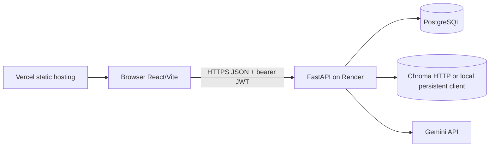
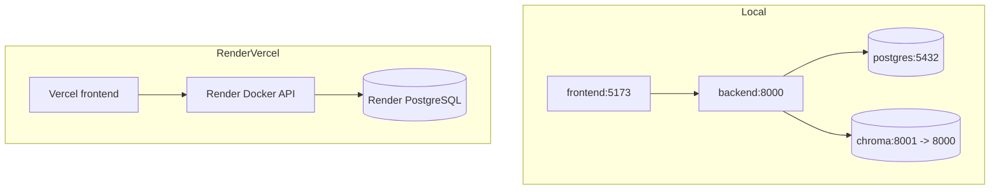

# 01 — System architecture

> Verified against commit `c85de7d` on 2026-10-19.

## In plain words

The browser is a static application. It calls a separate FastAPI service. The
API uses PostgreSQL for users, questions, attempts, and mastery, Chroma for
semantic chunks, and Gemini for generation and judging. Local Docker Compose
also runs PostgreSQL and Chroma; the Render blueprint only declares the API and
PostgreSQL ([`docker-compose.yml`](../../docker-compose.yml), [`render.yaml`](../../render.yaml)).

## Technical detail

`backend/app/main.py:create_app` installs CORS and routers. Database sessions
come from `backend/app/db/session.py:get_db`; the SQLAlchemy engine is created
from `DATABASE_URL`. Retrieval and ingestion construct/use the Chroma client
through service code. Gemini calls are isolated in generation/evaluation
services ([`backend/app/db/session.py`](../../backend/app/db/session.py),
[`backend/app/services/retrieval.py`](../../backend/app/services/retrieval.py)).

The synchronous boundary is each HTTP request: document upload performs
extraction/embedding before responding, and generation/evaluation wait for the
LLM. Blocking work is therefore inside the API worker process. The deployment
trust boundaries are the browser, API, database/vector services, and external
Gemini provider; secrets must remain server-side because Vite exposes
`VITE_*` values to the browser.

## Local versus deployed topology

The repository does not define a deployed Chroma service in `render.yaml`;
`CHROMA_HOST` and `CHROMA_PORT` are manually supplied there
([`render.yaml`](../../render.yaml)).

