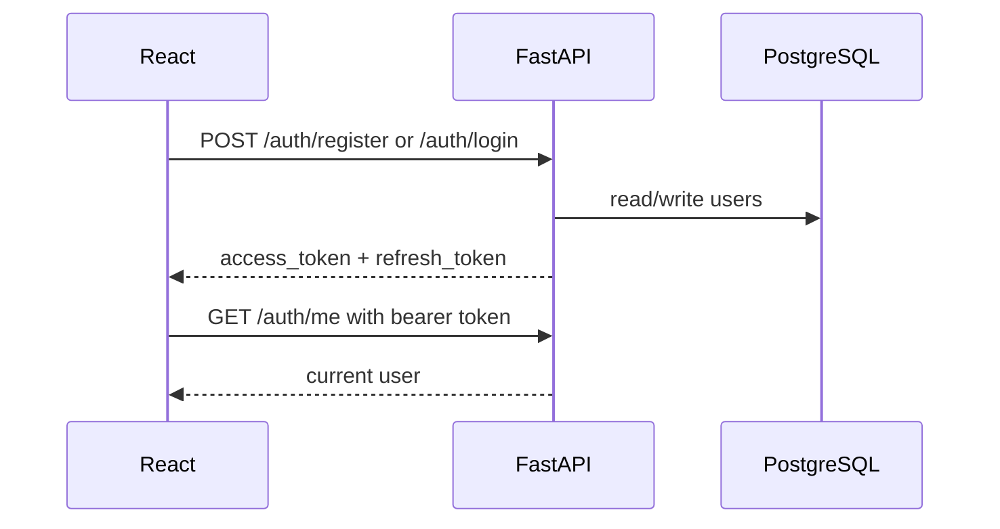
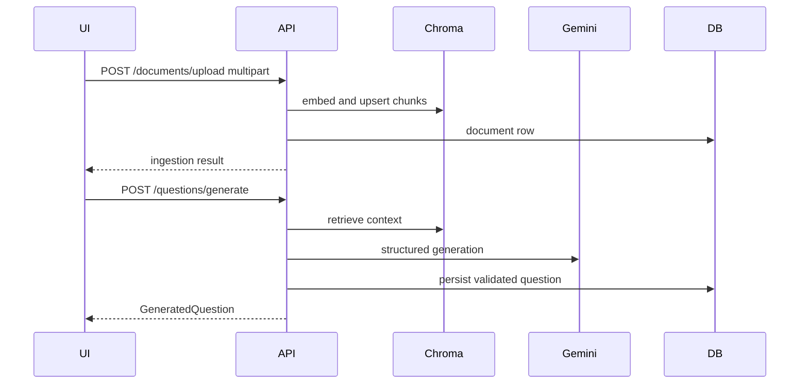

# 04 — Request workflows

> Verified against commit `c85de7d` on 2026-10-19.

## In plain words

Every protected route first resolves the JWT user and database session. Upload
and generation are synchronous. Attempts are committed before mastery updates
so an adaptive failure does not erase the learner's answer.

## Authentication

`/auth/register` returns 201; `/auth/login`, `/auth/token`, `/auth/refresh`
issue the shared `TokenResponse`; `/auth/me` returns the authenticated profile
([`backend/app/api/auth.py`](../../backend/app/api/auth.py)).

## Upload and generation

Upload reads at most the configured maximum plus one byte, rejects empty input,
defaults missing subject/topic to `General`, ingests, and returns chunk counts
([`backend/app/api/documents.py:upload_document`](../../backend/app/api/documents.py)).
Generation may retry topic-only retrieval, runs validation, retries generation
once with a correction note, and persists only a validated question
([`backend/app/api/questions.py:generate_questions`](../../backend/app/api/questions.py)).

## Submit, profile, history, health

`POST /attempts/submit` loads the question, rejects an empty answer, evaluates,
commits an `Attempt`, then attempts both mastery stores. `GET
/attempts/history/{user_id}` and `GET /profile/{user_id}` enforce owner-only
access. `GET /mastery/me` uses the user from JWT and optional filters.
`GET /health` reports service health and whether a Gemini key is configured
([`backend/app/api/attempts.py`](../../backend/app/api/attempts.py),
[`backend/app/api/profile.py`](../../backend/app/api/profile.py),
[`backend/app/api/mastery.py`](../../backend/app/api/mastery.py),
[`backend/app/main.py`](../../backend/app/main.py)).

