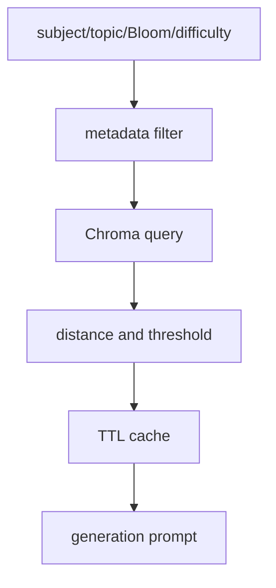

# 06 — Retrieval and RAG

> Verified against commit `c85de7d` on 2026-10-19.

## In plain words

Uploaded text is split into chunks and stored in a Chroma collection with
subject/topic/source metadata. Generation retrieves relevant chunks, preferring
college material and falling back to public/topic-only material when configured.
The retrieved text is passed to Gemini as grounding context.

## Technical detail

The retrieval service is the authoritative source for collection name, client
construction, metadata filters, result shaping, distance conversion, and the
in-memory TTL/size cache ([`backend/app/services/retrieval.py`](../../backend/app/services/retrieval.py)).
The application computes similarity from Chroma distance as described in the
service; do not infer a different metric from the word “RAG”.

The cache settings are `RETRIEVAL_CACHE_TTL_SECONDS=300` and
`RETRIEVAL_CACHE_MAX_ENTRIES=256` in the example configuration
([`.env.example`](../../.env.example), [`backend/app/core/config.py`](../../backend/app/core/config.py)).
The precise threshold and tier order must be read from the current retrieval
implementation; this blueprint does not invent a value that is not present in
the checked-out file.

## Consequences

Local Compose persists Chroma under a named volume. Render’s blueprint has no
Chroma resource, so production persistence and host/port values are deployment
inputs rather than guaranteed repository behaviour
([`docker-compose.yml`](../../docker-compose.yml), [`render.yaml`](../../render.yaml)).
If the client factory falls back to a local persistent store, that store is
local to the API container and can disappear on restart; confirm the current
factory branch before treating it as durable.

