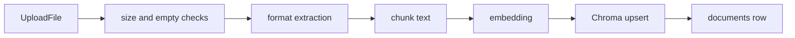

# 07 — Ingestion

> Verified against commit `c85de7d` on 2026-10-19.

## In plain words

The upload route accepts PDF, DOCX, TXT, and Markdown content. It enforces a
10 MB request-content limit in the route, rejects empty files, extracts text,
chunks it, embeds chunks, writes them to Chroma, and records the document.

## Technical detail

The route defaults absent subject/topic to `General`, passes `source_type` and
course through, and delegates extraction/chunking/upsert to
`ingest_document`. Filename sanitization and supported formats are implemented
in [`backend/app/services/ingestion_service.py`](../../backend/app/services/ingestion_service.py);
route-level validation is in
[`backend/app/api/documents.py`](../../backend/app/api/documents.py).

## Reliability and limits

The response exposes both compatibility names (`chunks_ingested` and
`chunks_count`). The database row stores status and chunk count. Chroma vectors
are shared at retrieval time while the document listing filters by uploader;
this is an intentional distinction in the route documentation
([`backend/app/schemas/schemas.py`](../../backend/app/schemas/schemas.py),
[`backend/app/api/documents.py`](../../backend/app/api/documents.py)).

Needs input from Om: confirm whether production uploads are also copied to
durable object storage. The model has `storage_path`, but the route’s current
contract does not prove a durable file-store implementation.

