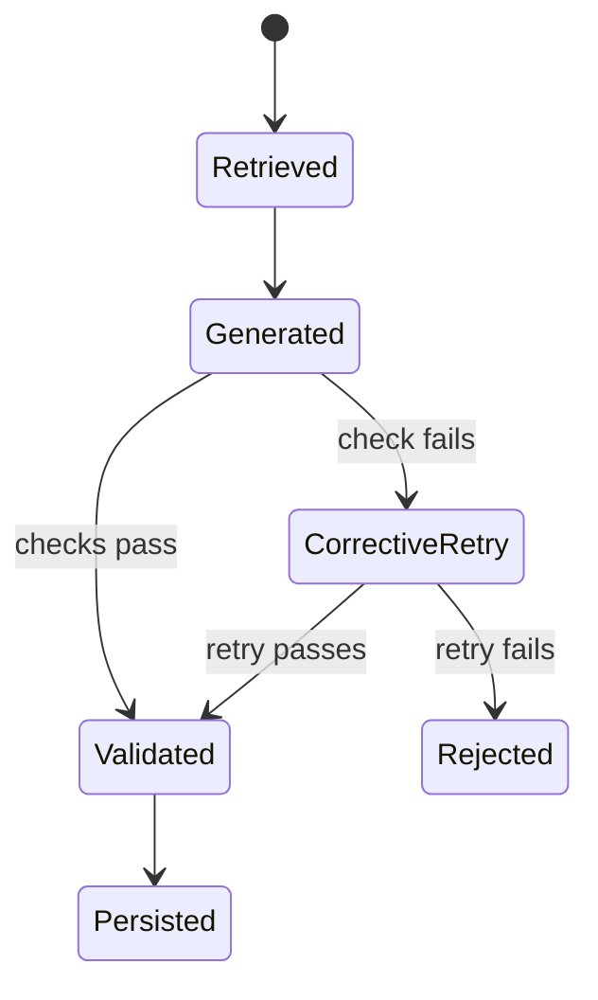

# 08 — Question generation and Bloom control

> Verified against commit `c85de7d` on 2026-10-19.

## In plain words

Generation targets one of six Bloom levels, a difficulty, a topic, and an open
or multiple-choice shape. Gemini returns structured data. The server checks
grounding, duplication, stem rules, and cognitive alignment before saving.
Failures receive one corrective retry, not an unbounded loop.

## Technical detail

The request validator requires `bloom_level` and `difficulty` unless
`adaptive=true`; `num_questions` is constrained to 1–10
([`backend/app/schemas/schemas.py:GenerateQuestionRequest`](../../backend/app/schemas/schemas.py)).
The route resolves adaptive targets from mastery, retrieves context, invokes
`generate_question`, validates it, and persists the question
([`backend/app/api/questions.py`](../../backend/app/api/questions.py)).

Validation logic and Bloom specifications live in
[`backend/app/services/validation_service.py`](../../backend/app/services/validation_service.py)
and related generation modules. The correction note explicitly distinguishes
duplicate, stem, cognitive, and grounding failures
([`backend/app/api/questions.py:_correction_note`](../../backend/app/api/questions.py)).

## Known limits

LLM alignment is probabilistic and the source context can be thin for concrete
Apply+ questions. The response carries `context_warning` when the implementation
sets one. The Bloom audit script documents methodology/results separately
([`scripts/bloom_audit.py`](../../scripts/bloom_audit.py),
[`scripts/bloom_audit_out.md`](../../scripts/bloom_audit_out.md)).

