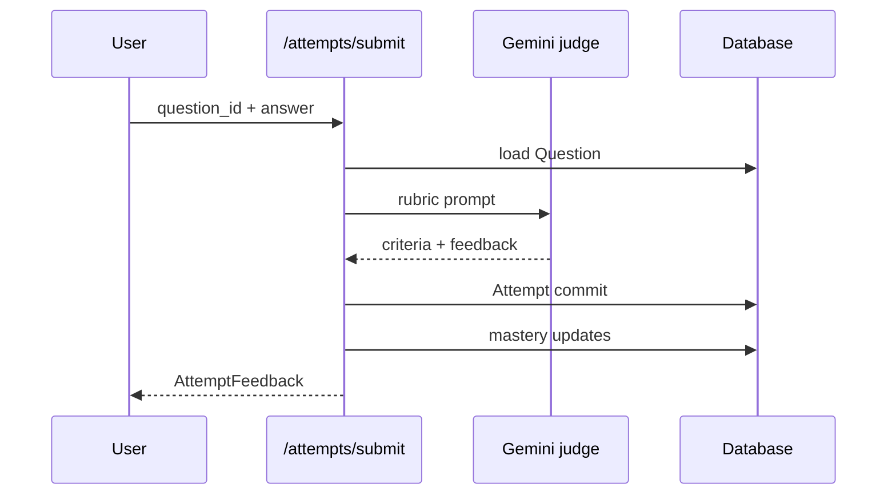

# 09 — Answer evaluation

> Verified against commit `c85de7d` on 2026-10-19.

## In plain words

The answer route loads the saved question, rejects blank text, asks Gemini to
judge the answer against a structured rubric, computes the stored normalized
score in application code, and returns strengths, missing points, feedback, and
the correct answer.

## Technical detail

`POST /attempts/submit` calls `evaluate_answer`, stores raw criteria scores and
serialized evaluation data, and exposes criteria normalized from 0–10 to 0–1
([`backend/app/api/attempts.py`](../../backend/app/api/attempts.py)).
The evaluation prompt, schema, injection handling, and weights are defined in
[`backend/app/services/evaluation_service.py`](../../backend/app/services/evaluation_service.py);
the implementation, rather than this document, is authoritative for exact
weights and score formula.

LLM-as-judge can be inconsistent, can be influenced by ambiguous questions, and
cannot replace human assessment. The code’s prompt and post-processing reduce
but do not eliminate that risk. Evaluation tests cover the implemented contract
([`backend/tests/test_evaluation_service.py`](../../backend/tests/test_evaluation_service.py)).

