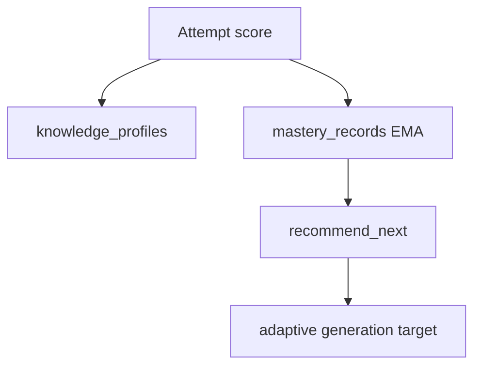

# 10 — Mastery and adaptive engine

> Verified against commit `c85de7d` on 2026-10-19.

## In plain words

An answer updates learner knowledge in two stores. `knowledge_profiles` supports
the adaptive service compatibility path; `mastery_records` stores subject/topic
EMA records used by `recommend_next`. The route preserves the attempt even if a
mastery update fails.

## Technical detail

`POST /attempts/submit` calls `update_mastery_profile`, then folds the same
attempt into `update_mastery` inside a nested transaction
([`backend/app/api/attempts.py`](../../backend/app/api/attempts.py)).
`POST /questions/generate` with `adaptive=true` calls `recommend_next` and
`explain_recommendation` and ignores supplied target values
([`backend/app/api/questions.py`](../../backend/app/api/questions.py)).

The exact EMA alpha, clamps, difficulty weights, and recommendation thresholds
are implementation facts in
[`backend/app/services/mastery_service.py`](../../backend/app/services/mastery_service.py)
and [`backend/app/services/adaptive_service.py`](../../backend/app/services/adaptive_service.py).
They should be kept synchronized with this chapter when changed; this version
does not guess values from variable names.

## Design caveat

Two stores increase compatibility but create consistency risk. The attempt is
the durable source event; mastery is a derived projection. A failed projection
is logged and does not roll back the answer, so repair/replay tooling would be
needed for strict eventual consistency.

