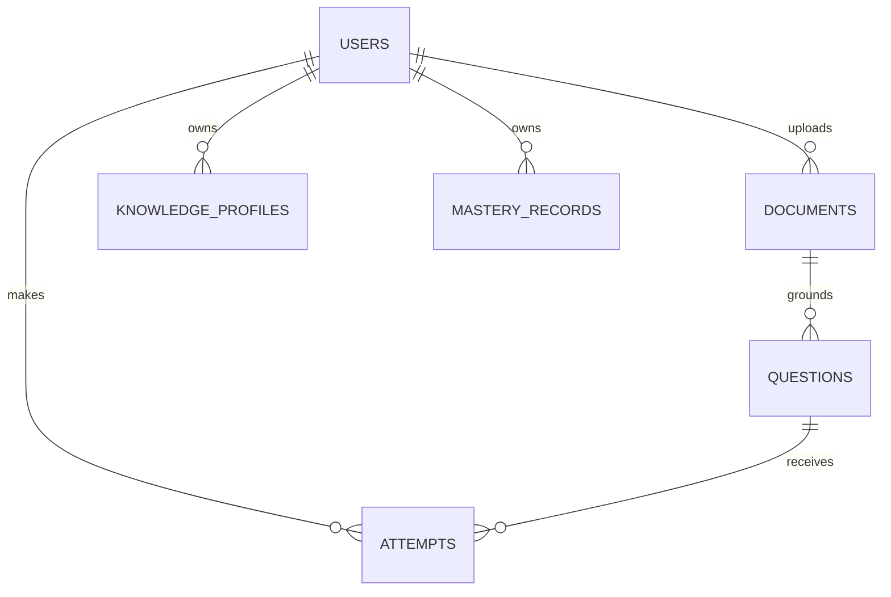

# 11 — Database design

> Verified against commit `c85de7d` on 2026-10-19.

## In plain words

SQLAlchemy models represent users, documents, questions, attempts, knowledge
profiles, and mastery records. Alembic revisions evolve the schema. PostgreSQL
uses JSONB for structured lists/maps, while SQLite receives a JSON variant for
tests/local use.

## Entity relationship

The model definitions, indexes, keys, nullable fields, and relationships are
in [`backend/app/models/models.py`](../../backend/app/models/models.py).
Notable indexes include questions by topic/Bloom/difficulty, attempts by
user/created time, and knowledge profiles by user/topic/Bloom. JSON fields
include question options/source IDs, attempt criteria, and evaluation data.

## Migration history

The repository contains these revisions, from initial schema through mastery:
`1012241bab96`, `b9c0d1e2f3a4`, `c7a1f4e2b9d3`, `d1e5b7c3a2f4`,
`e2a6c8d4b3f5`, `e2f6a8b1c4d5`, and `f3b7d9c1a2e4`
([`backend/alembic/versions`](../../backend/alembic/versions)).
`backend/Dockerfile` runs `alembic upgrade head` before Uvicorn.

## Transactions and portability

Routes commit explicit units. Attempt persistence is committed before derived
mastery updates. SQLAlchemy sessions are yielded and closed by
`get_db` ([`backend/app/db/session.py`](../../backend/app/db/session.py)).
This demonstrates atomic writes within a transaction, constraints, indexes,
normalization, and migrations; it does not prove distributed transactions
across PostgreSQL, Chroma, and Gemini.

