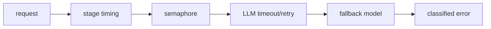

# 15 — Reliability and performance

> Verified against commit `c85de7d` on 2026-10-19.

## In plain words

The API uses warm-up, request IDs, stage timing, LLM timeouts, concurrency
limits, retries, fallback models, and retrieval caching. These controls improve
failure behaviour but do not remove cold starts or external provider quotas.

## Mechanisms

`WARMUP_ON_STARTUP` controls embedding/Chroma/schema warm-up. LLM settings
include timeout, maximum concurrency, thinking level, output caps, and fallback
models ([`backend/app/core/config.py`](../../backend/app/core/config.py),
[`.env.example`](../../.env.example)). Request timing and IDs are emitted by
the logging/timing modules ([`backend/app/core/logging.py`](../../backend/app/core/logging.py),
[`backend/app/core/timing.py`](../../backend/app/core/timing.py)).

## Honest performance boundary

The repository contains audit/performance scripts, but no externally verified
production latency SLO. Image model preloading increases build time and image
size to reduce the first embedding request
([`backend/Dockerfile`](../../backend/Dockerfile)). Synchronous ingestion and
LLM calls remain likely bottlenecks. Needs input from Om: supply repeatable
production measurements if they should be published as benchmark numbers.

