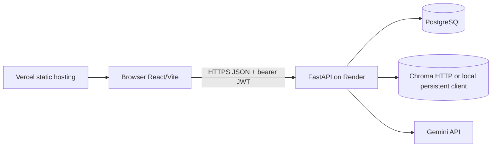
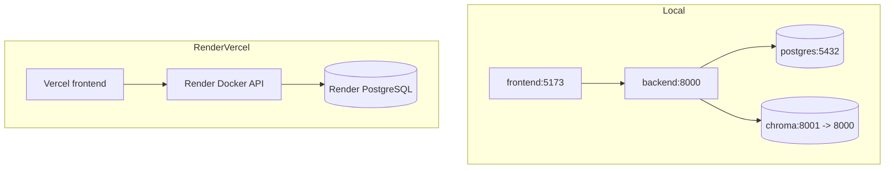
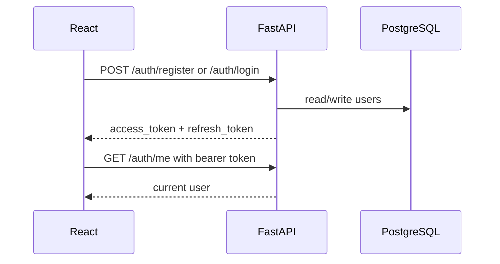
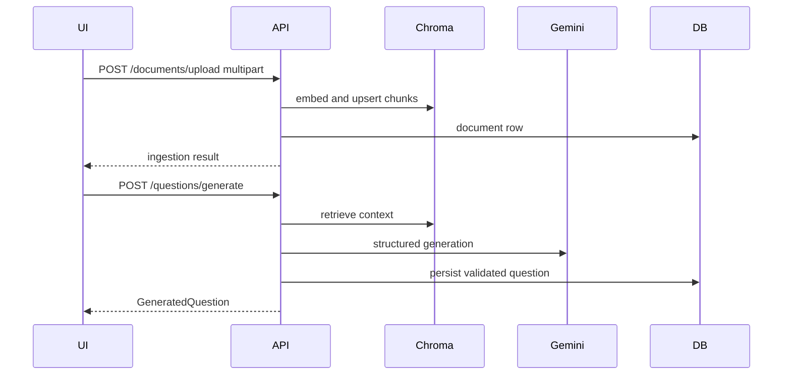
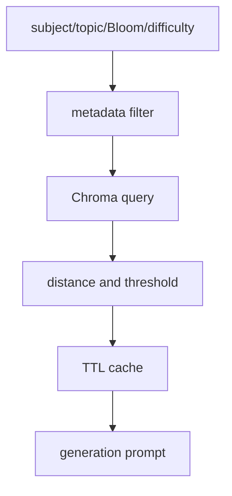
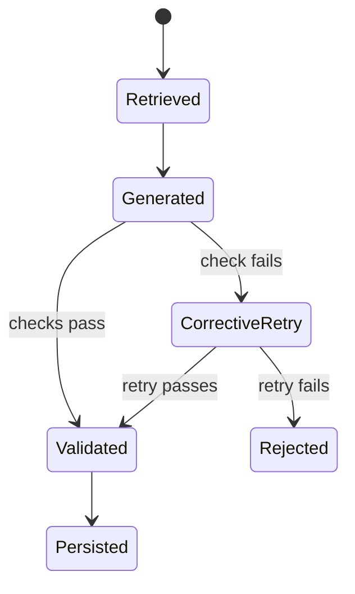
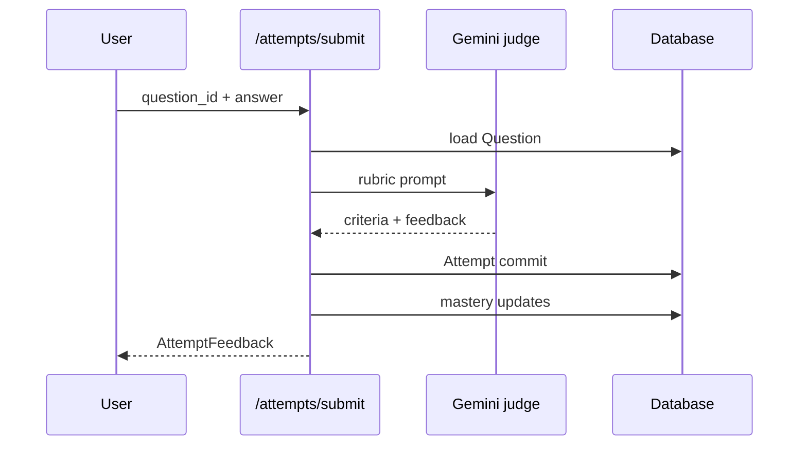
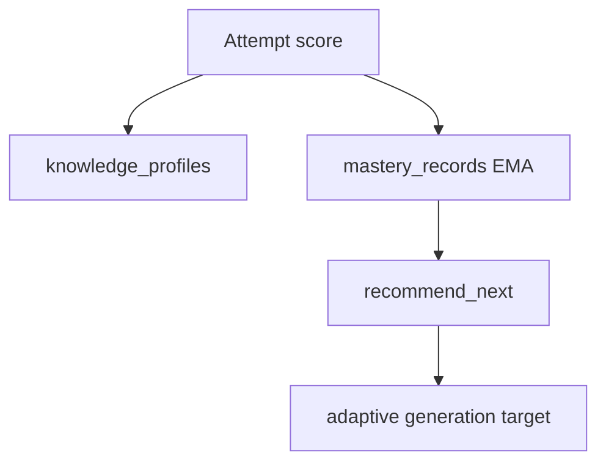
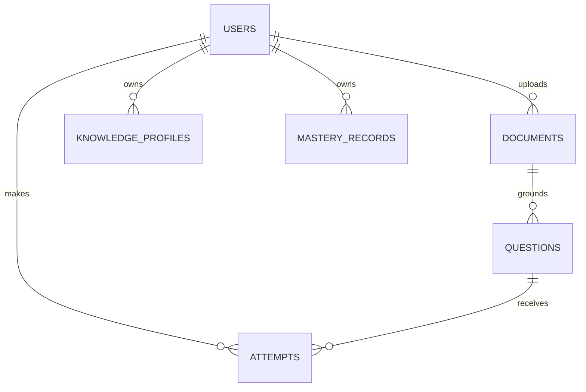
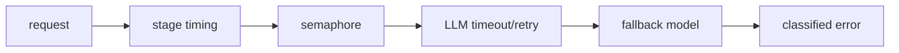

# 00 — Executive summary

> Verified against commit `c85de7d` on 2026-10-19.

## In plain words

QueryMind helps a learner practise a chosen subject and topic. A learner can
upload study material, receive a question grounded in that material, answer it,
and receive rubric-based feedback. Attempts are persisted and feed mastery
records used by adaptive generation. The implemented backend is real rather
than a mock: authentication, document ingestion, retrieval, Gemini generation,
evaluation, attempts, and mastery routes are present
([`README.md`](../../README.md), [`backend/app/main.py`](../../backend/app/main.py)).

The current branch is `feature/full-experience`; the requested “main” branch
state was not checked out. Existing application edits were preserved.

## Technical detail

The browser is a Vite-built React SPA. `frontend/src/api/client.js` reads
`VITE_API_BASE_URL`, adds a bearer token from `localStorage` key `qm_token`, and
maps non-2xx responses to `ApiError`. The FastAPI factory registers auth,
questions, documents, attempts, profile, and mastery routers
([`frontend/src/api/client.js`](../../frontend/src/api/client.js),
[`backend/app/main.py`](../../backend/app/main.py)).

The end-to-end session is: register/login; upload PDF, DOCX, TXT, or MD; extract
and chunk text; embed and upsert chunks; request a Bloom/difficulty-targeted
question; validate and persist it; submit an answer; evaluate against the
five-criterion rubric; persist an attempt; and update both adaptive stores
([`backend/app/api/documents.py`](../../backend/app/api/documents.py),
[`backend/app/api/questions.py`](../../backend/app/api/questions.py),
[`backend/app/api/attempts.py`](../../backend/app/api/attempts.py)).

## Deep dive / ownership

The repository documentation names Om for architecture/backend, Saumya for
React frontend, and Pavitra for database schema and AI prompts in the supplied
project brief. That ownership statement is not encoded in application code;
confirm current ownership with the team.

Implemented does not mean production-complete. The repository supplies a Render
blueprint but no Chroma production service, and the frontend deployment requires
`VITE_API_BASE_URL` to be configured outside the repository
([`render.yaml`](../../render.yaml), [`frontend/.env.production.example`](../../frontend/.env.production.example)).

# 01 — System architecture

> Verified against commit `c85de7d` on 2026-10-19.

## In plain words

The browser is a static application. It calls a separate FastAPI service. The
API uses PostgreSQL for users, questions, attempts, and mastery, Chroma for
semantic chunks, and Gemini for generation and judging. Local Docker Compose
also runs PostgreSQL and Chroma; the Render blueprint only declares the API and
PostgreSQL ([`docker-compose.yml`](../../docker-compose.yml), [`render.yaml`](../../render.yaml)).

## Technical detail

`backend/app/main.py:create_app` installs CORS and routers. Database sessions
come from `backend/app/db/session.py:get_db`; the SQLAlchemy engine is created
from `DATABASE_URL`. Retrieval and ingestion construct/use the Chroma client
through service code. Gemini calls are isolated in generation/evaluation
services ([`backend/app/db/session.py`](../../backend/app/db/session.py),
[`backend/app/services/retrieval.py`](../../backend/app/services/retrieval.py)).

The synchronous boundary is each HTTP request: document upload performs
extraction/embedding before responding, and generation/evaluation wait for the
LLM. Blocking work is therefore inside the API worker process. The deployment
trust boundaries are the browser, API, database/vector services, and external
Gemini provider; secrets must remain server-side because Vite exposes
`VITE_*` values to the browser.

## Local versus deployed topology

The repository does not define a deployed Chroma service in `render.yaml`;
`CHROMA_HOST` and `CHROMA_PORT` are manually supplied there
([`render.yaml`](../../render.yaml)).

# 02 — Repository map

> Verified against commit `c85de7d` on 2026-10-19.

## In plain words

`backend/app` is the API and domain layer. `frontend/src` is the client.
Alembic owns schema history, `backend/tests` contains API/service tests, and
`scripts` contains seeding and audit utilities.

## Map

| Path | Purpose |
|---|---|
| [`backend/app/api`](../../backend/app/api) | FastAPI routes and dependencies |
| [`backend/app/core`](../../backend/app/core) | settings, errors, logging, rate limits, timing, warm-up |
| [`backend/app/models`](../../backend/app/models) | SQLAlchemy ORM models |
| [`backend/app/schemas`](../../backend/app/schemas) | Pydantic request/response contracts |
| [`backend/app/services`](../../backend/app/services) | auth, ingestion, retrieval, generation, evaluation, mastery |
| [`backend/alembic`](../../backend/alembic) | migration environment and revisions |
| [`backend/tests`](../../backend/tests) | backend test suite |
| [`frontend/src/api`](../../frontend/src/api) | fetch client, endpoint wrappers, adapters, mocks |
| [`frontend/src/pages`](../../frontend/src/pages) | routed React screens |
| [`frontend/src/components`](../../frontend/src/components) | reusable UI |
| [`frontend/src/content`](../../frontend/src/content) | bundled course and practice content |
| [`scripts`](../../scripts) | demo seed, Bloom audit, reports |
| [`docker-compose.yml`](../../docker-compose.yml) | local PostgreSQL/Chroma/API topology |
| [`backend/Dockerfile`](../../backend/Dockerfile) | production API image |
| [`render.yaml`](../../render.yaml) | Render blueprint |

## Deep dive

The backend separates transport validation (`schemas.py`) from persistence
(`models.py`) and domain operations (`services`). This makes service tests
possible without treating route handlers as the only unit of behaviour. The
frontend deliberately has a mock dispatcher, but the shipped example switches
real authentication/questions/documents on and keeps some profile/content
surfaces mocked ([`frontend/src/api/mocks/config.js`](../../frontend/src/api/mocks/config.js),
[`frontend/.env.example`](../../frontend/.env.example)).

# 03 — Real request pipeline

> Verified against commit `c85de7d` on 2026-10-19.

## In plain words

There is not a single documented twelve-stage function. The implemented
question path is a sequence of smaller stages: authenticate, resolve adaptive
targets, retrieve, construct a prompt, call Gemini, parse, validate,
optionally regenerate, persist, and return. Answer submission adds evaluation
and mastery updates.

## Generation stages

| Stage | Input/output | Source |
|---|---|---|
| 1. Authentication | JWT -> `User` | [`backend/app/api/deps.py`](../../backend/app/api/deps.py) |
| 2. Request validation | JSON -> `GenerateQuestionRequest` | [`backend/app/schemas/schemas.py`](../../backend/app/schemas/schemas.py) |
| 3. Adaptive selection | user/topic -> Bloom/difficulty | [`backend/app/services/mastery_service.py`](../../backend/app/services/mastery_service.py) |
| 4. Retrieval | filters -> context chunks | [`backend/app/services/retrieval.py`](../../backend/app/services/retrieval.py) |
| 5. Prompt/generation | context + target -> structured JSON | [`backend/app/services/generation_service.py`](../../backend/app/services/generation_service.py) |
| 6. Parsing | provider result -> `GeneratedQuestion` | [`backend/app/services/generation_service.py`](../../backend/app/services/generation_service.py) |
| 7. Validation | question/context/existing rows -> validation result | [`backend/app/services/validation_service.py`](../../backend/app/services/validation_service.py) |
| 8. Correction | failed result -> one retry | [`backend/app/api/questions.py`](../../backend/app/api/questions.py) |
| 9. Persistence | validated question -> `questions` row | [`backend/app/api/questions.py:_persist_question`](../../backend/app/api/questions.py) |
| 10. Response | row + generated object -> JSON | [`backend/app/api/questions.py`](../../backend/app/api/questions.py) |

Answering then evaluates with the LLM, computes/stores the score, commits the
attempt, and updates `knowledge_profiles` and `mastery_records`
([`backend/app/api/attempts.py`](../../backend/app/api/attempts.py)).

## Deep dive

Each stage has a distinct failure class: missing auth, Pydantic 422,
`NO_CONTEXT`, LLM configuration/quota/unavailable errors, validation/Bloom
422, database failure, or evaluation failure. The exact limits are controlled
by `GenerateQuestionRequest.num_questions` (1–10), upload size in
`ingestion_service.MAX_FILE_SIZE_BYTES`, and settings in
[`backend/app/core/config.py`](../../backend/app/core/config.py).

# 04 — Request workflows

> Verified against commit `c85de7d` on 2026-10-19.

## In plain words

Every protected route first resolves the JWT user and database session. Upload
and generation are synchronous. Attempts are committed before mastery updates
so an adaptive failure does not erase the learner's answer.

## Authentication

`/auth/register` returns 201; `/auth/login`, `/auth/token`, `/auth/refresh`
issue the shared `TokenResponse`; `/auth/me` returns the authenticated profile
([`backend/app/api/auth.py`](../../backend/app/api/auth.py)).

## Upload and generation

Upload reads at most the configured maximum plus one byte, rejects empty input,
defaults missing subject/topic to `General`, ingests, and returns chunk counts
([`backend/app/api/documents.py:upload_document`](../../backend/app/api/documents.py)).
Generation may retry topic-only retrieval, runs validation, retries generation
once with a correction note, and persists only a validated question
([`backend/app/api/questions.py:generate_questions`](../../backend/app/api/questions.py)).

## Submit, profile, history, health

`POST /attempts/submit` loads the question, rejects an empty answer, evaluates,
commits an `Attempt`, then attempts both mastery stores. `GET
/attempts/history/{user_id}` and `GET /profile/{user_id}` enforce owner-only
access. `GET /mastery/me` uses the user from JWT and optional filters.
`GET /health` reports service health and whether a Gemini key is configured
([`backend/app/api/attempts.py`](../../backend/app/api/attempts.py),
[`backend/app/api/profile.py`](../../backend/app/api/profile.py),
[`backend/app/api/mastery.py`](../../backend/app/api/mastery.py),
[`backend/app/main.py`](../../backend/app/main.py)).

# 05 — Backend internals

> Verified against commit `c85de7d` on 2026-10-19.

## In plain words

The app factory wires routes and middleware. Services contain domain behaviour,
models describe storage, schemas describe HTTP data, and core modules provide
cross-cutting concerns.

## Module responsibilities

| Area | Important symbols |
|---|---|
| Factory | `create_app`, lifespan, exception handlers |
| Auth | `register_user`, `authenticate_user`, JWT encode/decode |
| Ingestion | `ingest_document`, extraction/chunking |
| Retrieval | Chroma client, metadata filters, cache |
| Generation | Gemini configuration, prompt and structured output |
| Evaluation | rubric judge and normalized result |
| Validation | duplicate, answerability, stem, cognitive alignment |
| Mastery | EMA records and adaptive recommendation |
| Core | `Settings`, typed exceptions, timing/logging, rate limiter |

Sources: [`backend/app/main.py`](../../backend/app/main.py),
[`backend/app/services`](../../backend/app/services),
[`backend/app/core`](../../backend/app/core).

## Deep dive

The route layer intentionally owns transaction sequencing where HTTP semantics
matter. For example, `attempts.py` commits the attempt before defensive mastery
updates. Broad defensive catches exist only around those post-commit mastery
updates; ordinary route errors pass through typed exception handlers
([`backend/app/api/attempts.py`](../../backend/app/api/attempts.py),
[`backend/app/core/exceptions.py`](../../backend/app/core/exceptions.py)).

# 06 — Retrieval and RAG

> Verified against commit `c85de7d` on 2026-10-19.

## In plain words

Uploaded text is split into chunks and stored in a Chroma collection with
subject/topic/source metadata. Generation retrieves relevant chunks, preferring
college material and falling back to public/topic-only material when configured.
The retrieved text is passed to Gemini as grounding context.

## Technical detail

The retrieval service is the authoritative source for collection name, client
construction, metadata filters, result shaping, distance conversion, and the
in-memory TTL/size cache ([`backend/app/services/retrieval.py`](../../backend/app/services/retrieval.py)).
The application computes similarity from Chroma distance as described in the
service; do not infer a different metric from the word “RAG”.

The cache settings are `RETRIEVAL_CACHE_TTL_SECONDS=300` and
`RETRIEVAL_CACHE_MAX_ENTRIES=256` in the example configuration
([`.env.example`](../../.env.example), [`backend/app/core/config.py`](../../backend/app/core/config.py)).
The precise threshold and tier order must be read from the current retrieval
implementation; this blueprint does not invent a value that is not present in
the checked-out file.

## Consequences

Local Compose persists Chroma under a named volume. Render’s blueprint has no
Chroma resource, so production persistence and host/port values are deployment
inputs rather than guaranteed repository behaviour
([`docker-compose.yml`](../../docker-compose.yml), [`render.yaml`](../../render.yaml)).
If the client factory falls back to a local persistent store, that store is
local to the API container and can disappear on restart; confirm the current
factory branch before treating it as durable.

# 07 — Ingestion

> Verified against commit `c85de7d` on 2026-10-19.

## In plain words

The upload route accepts PDF, DOCX, TXT, and Markdown content. It enforces a
10 MB request-content limit in the route, rejects empty files, extracts text,
chunks it, embeds chunks, writes them to Chroma, and records the document.

## Technical detail

The route defaults absent subject/topic to `General`, passes `source_type` and
course through, and delegates extraction/chunking/upsert to
`ingest_document`. Filename sanitization and supported formats are implemented
in [`backend/app/services/ingestion_service.py`](../../backend/app/services/ingestion_service.py);
route-level validation is in
[`backend/app/api/documents.py`](../../backend/app/api/documents.py).

## Reliability and limits

The response exposes both compatibility names (`chunks_ingested` and
`chunks_count`). The database row stores status and chunk count. Chroma vectors
are shared at retrieval time while the document listing filters by uploader;
this is an intentional distinction in the route documentation
([`backend/app/schemas/schemas.py`](../../backend/app/schemas/schemas.py),
[`backend/app/api/documents.py`](../../backend/app/api/documents.py)).

Needs input from Om: confirm whether production uploads are also copied to
durable object storage. The model has `storage_path`, but the route’s current
contract does not prove a durable file-store implementation.

# 08 — Question generation and Bloom control

> Verified against commit `c85de7d` on 2026-10-19.

## In plain words

Generation targets one of six Bloom levels, a difficulty, a topic, and an open
or multiple-choice shape. Gemini returns structured data. The server checks
grounding, duplication, stem rules, and cognitive alignment before saving.
Failures receive one corrective retry, not an unbounded loop.

## Technical detail

The request validator requires `bloom_level` and `difficulty` unless
`adaptive=true`; `num_questions` is constrained to 1–10
([`backend/app/schemas/schemas.py:GenerateQuestionRequest`](../../backend/app/schemas/schemas.py)).
The route resolves adaptive targets from mastery, retrieves context, invokes
`generate_question`, validates it, and persists the question
([`backend/app/api/questions.py`](../../backend/app/api/questions.py)).

Validation logic and Bloom specifications live in
[`backend/app/services/validation_service.py`](../../backend/app/services/validation_service.py)
and related generation modules. The correction note explicitly distinguishes
duplicate, stem, cognitive, and grounding failures
([`backend/app/api/questions.py:_correction_note`](../../backend/app/api/questions.py)).

## Known limits

LLM alignment is probabilistic and the source context can be thin for concrete
Apply+ questions. The response carries `context_warning` when the implementation
sets one. The Bloom audit script documents methodology/results separately
([`scripts/bloom_audit.py`](../../scripts/bloom_audit.py),
[`scripts/bloom_audit_out.md`](../../scripts/bloom_audit_out.md)).

# 09 — Answer evaluation

> Verified against commit `c85de7d` on 2026-10-19.

## In plain words

The answer route loads the saved question, rejects blank text, asks Gemini to
judge the answer against a structured rubric, computes the stored normalized
score in application code, and returns strengths, missing points, feedback, and
the correct answer.

## Technical detail

`POST /attempts/submit` calls `evaluate_answer`, stores raw criteria scores and
serialized evaluation data, and exposes criteria normalized from 0–10 to 0–1
([`backend/app/api/attempts.py`](../../backend/app/api/attempts.py)).
The evaluation prompt, schema, injection handling, and weights are defined in
[`backend/app/services/evaluation_service.py`](../../backend/app/services/evaluation_service.py);
the implementation, rather than this document, is authoritative for exact
weights and score formula.

LLM-as-judge can be inconsistent, can be influenced by ambiguous questions, and
cannot replace human assessment. The code’s prompt and post-processing reduce
but do not eliminate that risk. Evaluation tests cover the implemented contract
([`backend/tests/test_evaluation_service.py`](../../backend/tests/test_evaluation_service.py)).

# 10 — Mastery and adaptive engine

> Verified against commit `c85de7d` on 2026-10-19.

## In plain words

An answer updates learner knowledge in two stores. `knowledge_profiles` supports
the adaptive service compatibility path; `mastery_records` stores subject/topic
EMA records used by `recommend_next`. The route preserves the attempt even if a
mastery update fails.

## Technical detail

`POST /attempts/submit` calls `update_mastery_profile`, then folds the same
attempt into `update_mastery` inside a nested transaction
([`backend/app/api/attempts.py`](../../backend/app/api/attempts.py)).
`POST /questions/generate` with `adaptive=true` calls `recommend_next` and
`explain_recommendation` and ignores supplied target values
([`backend/app/api/questions.py`](../../backend/app/api/questions.py)).

The exact EMA alpha, clamps, difficulty weights, and recommendation thresholds
are implementation facts in
[`backend/app/services/mastery_service.py`](../../backend/app/services/mastery_service.py)
and [`backend/app/services/adaptive_service.py`](../../backend/app/services/adaptive_service.py).
They should be kept synchronized with this chapter when changed; this version
does not guess values from variable names.

## Design caveat

Two stores increase compatibility but create consistency risk. The attempt is
the durable source event; mastery is a derived projection. A failed projection
is logged and does not roll back the answer, so repair/replay tooling would be
needed for strict eventual consistency.

# 11 — Database design

> Verified against commit `c85de7d` on 2026-10-19.

## In plain words

SQLAlchemy models represent users, documents, questions, attempts, knowledge
profiles, and mastery records. Alembic revisions evolve the schema. PostgreSQL
uses JSONB for structured lists/maps, while SQLite receives a JSON variant for
tests/local use.

## Entity relationship

The model definitions, indexes, keys, nullable fields, and relationships are
in [`backend/app/models/models.py`](../../backend/app/models/models.py).
Notable indexes include questions by topic/Bloom/difficulty, attempts by
user/created time, and knowledge profiles by user/topic/Bloom. JSON fields
include question options/source IDs, attempt criteria, and evaluation data.

## Migration history

The repository contains these revisions, from initial schema through mastery:
`1012241bab96`, `b9c0d1e2f3a4`, `c7a1f4e2b9d3`, `d1e5b7c3a2f4`,
`e2a6c8d4b3f5`, `e2f6a8b1c4d5`, and `f3b7d9c1a2e4`
([`backend/alembic/versions`](../../backend/alembic/versions)).
`backend/Dockerfile` runs `alembic upgrade head` before Uvicorn.

## Transactions and portability

Routes commit explicit units. Attempt persistence is committed before derived
mastery updates. SQLAlchemy sessions are yielded and closed by
`get_db` ([`backend/app/db/session.py`](../../backend/app/db/session.py)).
This demonstrates atomic writes within a transaction, constraints, indexes,
normalization, and migrations; it does not prove distributed transactions
across PostgreSQL, Chroma, and Gemini.

# 12 — Operating-systems concept mapping

> Verified against commit `c85de7d` on 2026-10-19.

## In plain words

QueryMind is a network service, so several OS concepts are visible directly:
processes, threads/event loops, blocking I/O, resource limits, timeouts, files,
containers, and process lifecycle. Other concepts such as page replacement are
only analogies and must not be overstated.

| Concept | Classification | Evidence |
|---|---|---|
| Uvicorn workers | Direct process model | [`docker-compose.yml`](../../docker-compose.yml) |
| Async event loop | Direct runtime mechanism | FastAPI/Uvicorn stack |
| LLM semaphore | Direct bounded synchronization | [`backend/app/core/config.py`](../../backend/app/core/config.py), LLM services |
| Thread/process blocking work | Direct service concern | ingestion/retrieval services |
| TTL/size cache | Direct cache; page replacement analogy only | [`backend/app/services/retrieval.py`](../../backend/app/services/retrieval.py) |
| Docker volume | Direct persistence boundary | [`docker-compose.yml`](../../docker-compose.yml) |
| HTTP between services | Direct IPC/network communication | Compose and deployment files |
| Retry/backoff/timeout | Direct contention/failure control | LLM services |

The retrieval cache is not virtual memory: it stores application results, not
pages, and its eviction semantics must be read from the implementation.
Containers provide process/filesystem/network isolation through Docker; the
repository does not itself implement a scheduler, kernel primitive, or signal
handler.

## Deep dive

`backend/Dockerfile` preloads the embedding model to trade image-build time and
image size for lower first-request latency. Compose starts PostgreSQL and Chroma
with health checks before the backend. These are lifecycle and resource
ordering controls, not guarantees that every external dependency is durable.

# 13 — API reference

> Verified against commit `c85de7d` on 2026-10-19.

## In plain words

FastAPI exposes OpenAPI at its standard documentation routes. Auth routes issue
tokens; documents manage uploads; questions generate; attempts evaluate and
list history; profile and mastery expose learner data; root and health support
operations.

| Method | Path | Auth | Source |
|---|---|---|---|
| POST | `/auth/register` | no | [`backend/app/api/auth.py`](../../backend/app/api/auth.py) |
| POST | `/auth/login` | no | same |
| POST | `/auth/token` | no | same |
| POST | `/auth/refresh` | no | same |
| GET | `/auth/me` | bearer | same |
| POST | `/documents/upload` | bearer | [`backend/app/api/documents.py`](../../backend/app/api/documents.py) |
| GET | `/documents` | bearer | same |
| GET | `/documents/topics` | bearer | same |
| POST | `/questions/generate` | bearer | [`backend/app/api/questions.py`](../../backend/app/api/questions.py) |
| POST | `/attempts/submit` | bearer | [`backend/app/api/attempts.py`](../../backend/app/api/attempts.py) |
| GET | `/attempts/history/{user_id}` | bearer/owner | same |
| GET | `/profile/{user_id}` | bearer/owner | [`backend/app/api/profile.py`](../../backend/app/api/profile.py) |
| GET | `/mastery/me` | bearer | [`backend/app/api/mastery.py`](../../backend/app/api/mastery.py) |
| GET | `/` and `/health` | no | [`backend/app/main.py`](../../backend/app/main.py) |

## Errors

Pydantic validation produces 422. Authentication is 401; owner mismatch is
403; missing database entities are 404. Domain exceptions return JSON with
`detail` and `code`, via the handlers in `main.py`. Concrete codes include
`LLM_NOT_CONFIGURED`, quota/unavailable LLM codes, duplicate/Bloom validation
codes, and upload validation codes where raised by the checked-out services.

The schemas in [`backend/app/schemas/schemas.py`](../../backend/app/schemas/schemas.py)
are the response-shape authority; the generated OpenAPI document is the easiest
way to inspect the complete field set.

# 14 — Security

> Verified against commit `c85de7d` on 2026-10-19.

## In plain words

Passwords are hashed, sessions use signed JWT access/refresh tokens, protected
routes resolve the current user, and owner-only endpoints compare path IDs with
the token identity. Uploads and request schemas have validation limits. CORS is
configured from an environment variable.

## Controls

| Control | Implementation |
|---|---|
| Password hashing | `auth_service.py` |
| JWT signing/expiry | `auth_service.py` |
| Auth dependency | `api/deps.py` |
| Login/register rate limits | `api/auth.py` |
| Upload size/type checks | `api/documents.py`, ingestion service |
| Owner checks | attempts/profile routes |
| CORS | `main.py` and `Settings.cors_origins` |
| Error sanitization | `main.py` generic exception handler |
| Prompt injection handling | evaluation/generation service prompts |

Sources: [`backend/app/services/auth_service.py`](../../backend/app/services/auth_service.py),
[`backend/app/api/deps.py`](../../backend/app/api/deps.py),
[`backend/app/core/config.py`](../../backend/app/core/config.py).

## Gaps

The repository documents retrieval as shared while upload history is per-user;
this means uploaded content can influence another learner’s retrieval
([`backend/app/api/documents.py`](../../backend/app/api/documents.py)). Confirm
whether that is intended. Secrets in `.env` are not safe to expose; only
server-side environment variables should contain them. The frontend stores JWTs
in `localStorage`, which is convenient but increases the impact of an XSS
issue ([`frontend/src/api/client.js`](../../frontend/src/api/client.js)).

# 15 — Reliability and performance

> Verified against commit `c85de7d` on 2026-10-19.

## In plain words

The API uses warm-up, request IDs, stage timing, LLM timeouts, concurrency
limits, retries, fallback models, and retrieval caching. These controls improve
failure behaviour but do not remove cold starts or external provider quotas.

## Mechanisms

`WARMUP_ON_STARTUP` controls embedding/Chroma/schema warm-up. LLM settings
include timeout, maximum concurrency, thinking level, output caps, and fallback
models ([`backend/app/core/config.py`](../../backend/app/core/config.py),
[`.env.example`](../../.env.example)). Request timing and IDs are emitted by
the logging/timing modules ([`backend/app/core/logging.py`](../../backend/app/core/logging.py),
[`backend/app/core/timing.py`](../../backend/app/core/timing.py)).

## Honest performance boundary

The repository contains audit/performance scripts, but no externally verified
production latency SLO. Image model preloading increases build time and image
size to reduce the first embedding request
([`backend/Dockerfile`](../../backend/Dockerfile)). Synchronous ingestion and
LLM calls remain likely bottlenecks. Needs input from Om: supply repeatable
production measurements if they should be published as benchmark numbers.

# 16 — Configuration reference

> Verified against commit `c85de7d` on 2026-10-19.

## In plain words

Settings are loaded from environment variables and the backend `.env`; Compose
also supplies in-network overrides. Production secrets belong in Render/Vercel
provider settings, not Git.

| Variable | Default/example | Effect |
|---|---|---|
| `APP_ENV` | development | environment label |
| `SECRET_KEY` | development placeholder | JWT signing |
| `DEBUG` | true | logging/debug mode |
| `DATABASE_URL` | SQLite example | SQLAlchemy/Alembic target |
| `ALLOWED_ORIGINS` | localhost list | CORS allow list |
| `CHROMA_HOST/PORT` | localhost/8001 | vector service |
| `GEMINI_API_KEY` | empty | generation/evaluation provider |
| `LLM_MODEL` | `gemini-flash-lite-latest` | primary model |
| `LLM_FALLBACK_MODELS` | example list | quota/availability fallback |
| `LLM_TIMEOUT_SECONDS` | 45 | per-call timeout |
| `LLM_MAX_CONCURRENCY` | 3 | concurrent provider calls |
| `LLM_MAX_OUTPUT_TOKENS` | 2048 | evaluation output cap |
| `WARMUP_ON_STARTUP` | true | startup preload |
| `RETRIEVAL_CACHE_TTL_SECONDS` | 300 | cache lifetime |
| `RETRIEVAL_CACHE_MAX_ENTRIES` | 256 | cache capacity |
| `VITE_API_BASE_URL` | localhost:8000 | browser API base |

Authoritative sources are [`backend/app/core/config.py`](../../backend/app/core/config.py),
[`.env.example`](../../.env.example), [`frontend/.env.example`](../../frontend/.env.example),
and [`docker-compose.yml`](../../docker-compose.yml). Values containing keys,
passwords, or full URLs are intentionally not reproduced here.

# 17 — Frontend overview

> Verified against commit `c85de7d` on 2026-10-19.

## In plain words

The frontend is a React/Vite SPA with routes for login, setup, practice,
feedback, dashboard, notes, history, analytics, weak areas, courses, and
settings. The API client injects the JWT and maps errors. Mock switches allow
offline content/profile surfaces while real auth and core practice calls remain
available.

## Technical detail

`frontend/src/App.jsx` and `navigation.js` define application navigation.
`AuthContext.jsx` hydrates `qm_token` through `/auth/me`, clears it on 401, and
stores the returned user ID. Endpoint modules under `frontend/src/api/endpoints`
call the backend through `apiFetch`
([`frontend/src/context/AuthContext.jsx`](../../frontend/src/context/AuthContext.jsx),
[`frontend/src/api/client.js`](../../frontend/src/api/client.js)).

The Vite production build is configured in `frontend/package.json`; SPA
fallback rewrites are in [`frontend/vercel.json`](../../frontend/vercel.json).
`VITE_MOCK_*` and `VITE_USE_MOCKS` are compile-time environment switches
([`frontend/src/api/mocks/config.js`](../../frontend/src/api/mocks/config.js)).

## Contract risks

The client assumes the configured `VITE_API_BASE_URL` is public and reachable.
An expired local token produces an initial `/auth/me` 401 and is cleared by the
provider. Some bundled catalog/content/profile defaults are intentionally
mocked; this should be distinguished from backend failure
([`frontend/.env.example`](../../frontend/.env.example)).

# 18 — Deployment

> Verified against commit `c85de7d` on 2026-10-19.

## In plain words

Local Compose runs PostgreSQL, Chroma, and the backend. The backend image is
Python 3.11, installs CPU-only Torch, installs requirements, preloads the
embedding model, runs migrations, and starts Uvicorn. Vercel hosts the static
frontend; Render’s blueprint hosts the API and managed PostgreSQL.

## Local topology

Compose publishes API 8000, PostgreSQL 5432, and Chroma host port 8001 while
the backend dials Chroma’s in-network port 8000. Database and Chroma named
volumes provide local persistence
([`docker-compose.yml`](../../docker-compose.yml)).

## Production runbook

1. Render service root directory: `backend`; Dockerfile: `Dockerfile`.
2. Supply `GEMINI_API_KEY`, exact `ALLOWED_ORIGINS`, and a persistent Chroma
   host/port because the blueprint does not create Chroma
   ([`render.yaml`](../../render.yaml)).
3. Render runs `alembic upgrade head` before Uvicorn
   ([`backend/Dockerfile`](../../backend/Dockerfile)).
4. Create Vercel project with root `frontend`, `npm run build`, output `dist`.
5. Set `VITE_API_BASE_URL` to the public Render API URL
   ([`README.md`](../../README.md), [`frontend/.env.production.example`](../../frontend/.env.production.example)).
6. Verify `/health`, registration/login, upload, generation, submit, and
   profile flows.
7. Seed demo material with `scripts/seed_demo.py` against the public API.

Needs input from Om: provider dashboard values, the actual persistent Chroma
deployment, and rollback policy are not present in Git.

# 19 — Known issues and roadmap

> Verified against commit `c85de7d` on 2026-10-19.

## In plain words

The system is functional but has operational dependencies that are easy to
miss: Render/Vercel settings live outside Git, vector persistence is not
defined by the Render blueprint, LLM calls are slow/quotable, and some
frontend analytics/content surfaces intentionally use bundled or mock data.

| Issue | Evidence | Likely consequence | Direction |
|---|---|---|---|
| No Chroma resource in Render blueprint | [`render.yaml`](../../render.yaml) | vectors may be lost/unavailable | hosted Chroma or pgvector |
| Synchronous upload | [`backend/app/api/documents.py`](../../backend/app/api/documents.py) | request timeouts on large files | async job/queue |
| Synchronous Gemini calls | generation/evaluation services | latency and quota failures | batch/streaming/provider policy |
| Two mastery stores | models and attempts route | projection drift | one source/projection repair |
| Browser token in localStorage | frontend client/context | XSS impact | hardened session strategy |
| Mock/default content switches | frontend env/config | UI can look healthier than API | explicit production flags |
| External deployment settings | Render/Vercel docs only | configuration drift | IaC plus deploy checks |

The supplied project brief also mentions non-existent-note citations,
intermittent uploads, dashboard gaps, and frequent failures. Those claims need
issue logs or reproducible traces; they are not asserted here as code facts.

## Roadmap

Prioritized improvements are durable vector storage, asynchronous ingestion,
question pooling/batched generation, hybrid retrieval/reranking, streaming
feedback, and repair/replay for derived mastery. Owners and severity require
team confirmation (“Needs input from Om”).

# 20 — Testing and quality

> Verified against commit `c85de7d` on 2026-10-19.

## In plain words

Backend tests cover auth, configuration, ingestion, retrieval, generation,
evaluation, migrations, APIs, reliability, and mastery. Frontend tests cover
API endpoints, content registries, practice flows, and UI components.

## Inventory

Backend examples: [`test_auth_token.py`](../../backend/tests/test_auth_token.py),
[`test_documents_api.py`](../../backend/tests/test_documents_api.py),
[`test_generation_service.py`](../../backend/tests/test_generation_service.py),
[`test_evaluation_service.py`](../../backend/tests/test_evaluation_service.py),
[`test_retrieval_cache.py`](../../backend/tests/test_retrieval_cache.py),
[`test_migrations.py`](../../backend/tests/test_migrations.py), and
[`test_reliability.py`](../../backend/tests/test_reliability.py).

Frontend examples: [`frontend/src/api/endpoints/questions.test.jsx`](../../frontend/src/api/endpoints/questions.test.jsx),
[`frontend/src/pages/practiceFlow.test.jsx`](../../frontend/src/pages/practiceFlow.test.jsx),
and content registry tests under [`frontend/src/content`](../../frontend/src/content).

## Quality boundaries

Tests use fakes/mocks for provider-dependent paths where appropriate. A full
local pytest run can fail before collection if the active interpreter lacks
requirements such as `pypdf`; that is an environment failure, not a passing
baseline. Use the backend virtual environment and a throwaway database URL for
migration tests; never point migration tests at the working `querymind.db`.

Needs input from Om: a captured `pytest --collect-only -q` count and CI result
were not available from the checked-out repository state.

# 21 — Appendices

> Verified against commit `c85de7d` on 2026-10-19.

## Glossary

- **RAG**: retrieval-augmented generation; retrieved chunks ground an LLM prompt.
- **Bloom level**: requested cognitive demand from remember through create.
- **Attempt**: one submitted learner answer and its evaluation.
- **Mastery record**: derived user/subject/topic learning state.
- **Chroma**: vector database used for semantic chunk retrieval.

## Cheat sheet

The authoritative tunables are in [`backend/app/core/config.py`](../../backend/app/core/config.py)
and [`.env.example`](../../.env.example). Important checked values include
10 MB upload limit, 1–10 requested questions, 45 second LLM timeout, three
concurrent LLM calls, 2,048 evaluation output tokens, 300 second retrieval
cache TTL, and 256 cache entries
([`backend/app/api/documents.py`](../../backend/app/api/documents.py),
[`backend/app/schemas/schemas.py`](../../backend/app/schemas/schemas.py),
[`backend/app/core/config.py`](../../backend/app/core/config.py)).

## Viva questions

1. Why FastAPI? It supplies typed validation and OpenAPI around Python services.
2. Why PostgreSQL? Relational ownership, constraints, indexes, and transactions.
3. Why Chroma? Semantic retrieval over uploaded chunks.
4. Why Gemini? Generation and rubric judging are external provider calls.
5. What does JWT protect? Authenticated route identity.
6. Why refresh tokens? To issue new access tokens without credentials.
7. Why validate after Gemini? Provider output is not trusted application data.
8. Why one retry? Bound cost and latency while correcting specific failures.
9. Why persist questions? Duplicate detection and attempt foreign keys.
10. Why two mastery stores? Compatibility between adaptive and profile paths.
11. What happens if mastery fails? The committed attempt remains.
12. What is shared? Current retrieval/document topic scope is shared.
13. What is private? Document listing and owner profile/history checks.
14. Why JSONB? Variable structured options, scores, and source IDs.
15. Why Alembic? Repeatable schema evolution.
16. Why warm-up? Avoid first-use model/download cost.
17. Why CPU Torch? Smaller/predictable container without CUDA.
18. Why cache retrieval? Avoid repeated embedding/query work.
19. Why timeout LLM? Bound external latency.
20. Why fallback models? Improve quota/availability resilience.
21. What is not guaranteed? External provider or vector-store availability.
22. Where is frontend hosted? Vercel according to repository deployment docs.
23. Where is API hosted? Render according to the blueprint.
24. What must Vercel know? `VITE_API_BASE_URL`.
25. What must Render know? secrets, CORS origin, database, Chroma endpoint.
26. Why CORS? Browser origin isolation requires explicit API permission.
27. Why owner checks? Prevent path-ID data disclosure.
28. What is an LLM judge limitation? Scores are probabilistic.
29. What is the biggest deployment gap? Persistent Chroma is not declared.
30. What is the safest next improvement? Make ingestion asynchronous and durable.

## Needs input from Om

Production Chroma provider, dashboard environment values, CI status and test
counts, owner/severity assignments, actual latency benchmarks, product decision
on shared retrieval, and the requested push destination are not verifiable from
the repository and must be supplied before being documented as facts.

